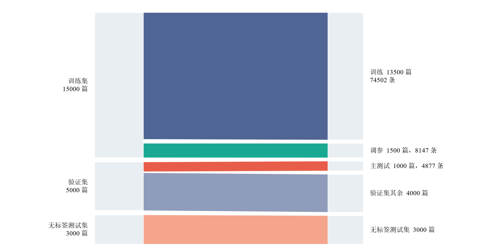
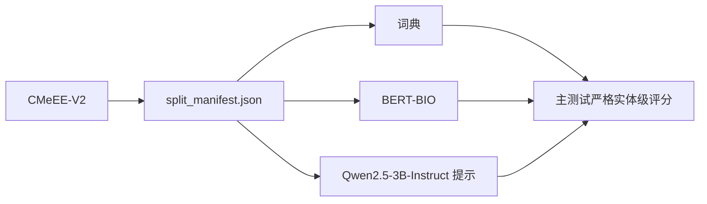
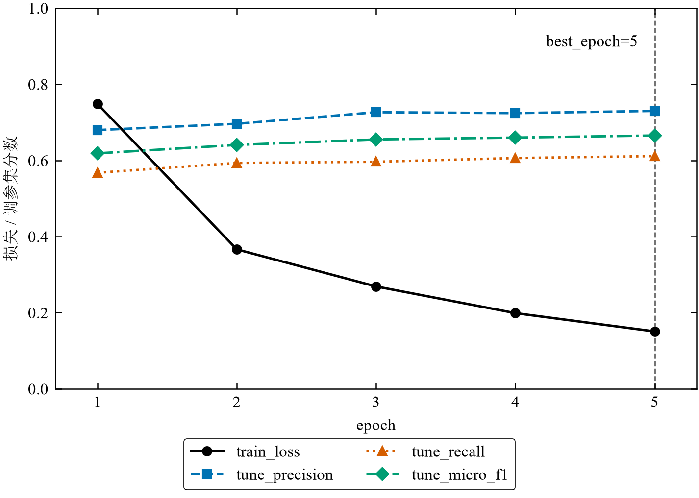

# 中文医疗实体抽取

**课程**：自然语言处理（2026—2027 秋季学期）　**组长学号 / 姓名**：________________　**方向**：B

**成员与分工**：见第⑧节。姓名、学号与工作量本文件不代填。

**提交日期**：________________　**仓库地址**：________________　**演示录屏**：________________

---

## 摘要

本项目在 CMeEE-V2 上抽取九类医学实体。种子 42，主测试 1000 篇来自官方验证集。严格实体级 Micro-F1：词典最长匹配 0.3924，BERT-BIO 0.6348，Qwen2.5-3B 单示例 0.0224。BERT 的 token 级 Micro-F1 为 0.7770。示例条数按调参集规则选 1；0 与 3 示例的主测试早于这次选择。单示例低分里，解析失败只占很小一部分，大量自报表面能对上金标，提交的字符下标却对不上。

## ① 问题定义与背景

任务是从中文医学句子中抽出九类实体：`dis`、`sym`、`dru`、`equ`、`pro`、`bod`、`ite`、`mic`、`dep`。数据在 `data/raw/CMeEE-V2/`。`README.txt` 写明评估以严格 Micro-F1 为准。下标左闭右开，`text[start_idx:end_idx] == entity`。一条预测算对，当且仅当 `start_idx`、`end_idx`、`type` 都相同。官方无标签的 `CMeEE-V2_test.json`（3000 篇）不评分。

使用对象是课程中的信息抽取实验，不是临床决策系统。抽出的实体可供后续检索或编码使用，本仓库没有接入医院系统，也不输出诊断或用药建议。成功判据是：同一主测试上同时有非大模型基线、监督序列标注和冻结大模型提示；指标为严格实体级 Micro-F1；调参只使用 1500 篇调参集；至少展示三类真实错误并能从预测文件复核。开题时没有预设一个必须达到的 F1 数字。

主测试索引以 `data/processed/split_manifest.json` 为准。规模：项目训练 13500 篇（74502 个实体），调参 1500 篇（8147），主测试 1000 篇（4877）。文档数与实体数来自 `outputs/data_validation_summary.json` 和 `outputs/metrics/split_profile.json`。主测试有 4 篇空文档。

原始三份 JSON 在 2026-10-14 校验时 `error_counts` 都是空的：类型在九类之内，下标类型正确，且已经满足 `text[start:end] == entity`。校验程序只计数，不改写下标，也不丢弃非法标注；这批文件里没有需要丢弃的记录。划分内重复文本：训练 35 条文本出现多次，调参 2 条，主测试 0 条。跨划分完全相同的文本有 6 条，都在训练和调参之间；主测试与另外两份没有相同文本。计数在 `outputs/metrics/report_diagnostics.json` 的 `duplicate_texts`。



**图 1.** 官方文件的文档构成。训练、调参和主测试的实体数在图例中，来自 `outputs/metrics/split_profile.json`。

## ② 相关工作与方案选型

选题是任务书方向 B（信息抽取 / 序列标注）。方向 A、C 不是技术禁区。本项目不采用 RAG 和 LoRA，是因为任务约束和已选对照，不是因为「不属于某方向」。

待抽实体是当前句里的连续片段，评分看字符区间和类型。外部检索不能直接决定 `start_idx`、`end_idx` 和 `type`，检索噪声还会引入句外字符串。因此没有做 RAG，仓库里也没有检索脚本。

监督信号由 BERT-BIO 承担：13500 篇有标签，损失是 token 分类，权重会更新。Qwen 侧保持冻结，用来看提示条数本身的变化。LoRA 仍要训练秩、学习率和显存，会和「是否更新权重」缠在一起，截止前没有实现。中文医疗 NER 文献里，指令微调常常高于少样本提示，那是另一套训练设置，不能拿来代替本实验的结论。

| 方案 | 本项目 | 理由 |
| --- | --- | --- |
| 词典全匹配、最长匹配 | 已实现 | 只用 `data/processed/train.json` 的表面。全匹配保留重叠，最长匹配在冲突时留更长跨度。主测试严格实体级 Micro-F1 0.2524 与 0.3924 |
| BERT-BIO | 已实现 | `bert-base-chinese`，逐位置 BIO。主测试实体级 0.6348。每位置一个标签，嵌套要先压平 |
| Qwen2.5-3B-Instruct 提示 | 已实现 | 权重不更新。调参集比较 0/1/3 条示例后按规则取 1，单示例主测试实体级 0.0224。0 与 3 示例的主测试在这次选择之前已经跑过 |
| RAG | 未实现 | 证据在输入句内；检索不产生严格三元组 |
| LoRA | 未实现 | 领域监督已由 BERT 完成；Qwen 冻结以便单独看示例条数 |

六位小数在 `outputs/metrics/dictionary_baseline.csv`、`bert_bio.csv`、`qwen_3b.csv`、`qwen_3b_one.csv`。选择记录在 `qwen_shot_count_selection.json`。

## ③ 系统设计



**图 2.** 已实现的数据流。词典只读项目训练集。BERT 读 train、tune、test。Qwen 的示例下标来自 train，预测写入 `outputs/predictions/`。三路都用 `start_idx`、`end_idx`、`type` 评分。调参集用于 BERT 选检查点和 Qwen 选示例条数，不并进主测试表。

## ④ 实现细节

环境是 conda `medical_ner`，Python 3.11.17。直接相关的版本写在 `requirements.txt`：torch 2.6.0+cu124，transformers 5.19.0，bitsandbytes 0.50.2，accelerate 1.15.0，safetensors 0.8.0，numpy 2.4.6，PyYAML 6.0.3，matplotlib 3.11.2。GPU 为 NVIDIA GeForce RTX 4060 Laptop，8188 MiB。训练日志 `oom_fallback=none`，没有把 batch 降到 4。种子 42。`scripts/train_bert_bio.py` 的 `set_seed` 和 `scripts/run_qwen_3b.py` 的加载函数调用的是 `random.seed`、`numpy.random.seed`、`torch.manual_seed`，以及在 CUDA 可用时的 `torch.cuda.manual_seed_all`。PyTorch 没有 `torch.manual_seed_all` 这个名字。

模型标识：BERT 为本地目录 `D:/models/bert-base-chinese`，加载 `BertForTokenClassification`，标签数 19（`O` 加九类的 `B-`/`I-`）。Qwen 为本地 `D:/models/Qwen2.5-3B-Instruct`，不是 Base 模型。4bit 配置是 NF4、双重量化、计算 dtype float16，`device_map=auto`。加载失败则进程退出，不改精度、不缩小测试集。

### BERT 训练与检查点

`configs/bert_bio.yaml`：学习率 `3e-5`，batch 8，梯度累积 2，有效 batch 16，最长 256，fp16，权重衰减 0.01（bias 和 LayerNorm 不衰减），warmup 比例 0.1。计划 5 轮，早停耐心 2。选择指标是调参集上**原始金标**的严格实体级 Micro-F1，并列时取更早的轮次。五轮该指标持续上升（0.6186 → 0.6654），`best_epoch=5`，`stopped_early=false`。主测试只用这一份检查点，`test_eval_count=1`。调参集 F1 0.6654 不是主测试成绩。曲线见附录图 3，日志见 `outputs/logs/train_bio.log`。

长句按正文 token 滑窗：窗口内容最多 254（留给 `[CLS]` 和 `[SEP]`），步长 64。主测试 1000 篇都是单窗，`test_window_cut=0`。训练 32 篇、调参 9 篇超过一窗。重叠窗口上的相同三元组在解码时只留一次。

### 字符下标与 token 标签

fast tokenizer 关闭特殊符号后给出 offset。实体先按长度降序、原文顺序贪心压平，重叠者丢弃。一个 WordPiece 只属于一个保留实体。实体完整落在窗口内时，第一个相交子词标 `B-类型`，其余标 `I-类型`。`[CLS]`、`[SEP]` 和 padding 的标签是 `-100`，交叉熵忽略。解码只从 `B-` 起段，同类 `I-` 延续；单独的 `I-` 不会开新实体。还原下标必须满足 `0 <= start < end <= len(text)`。

子词边界对不齐的计数：训练 156、调参 34、主测试 12（`train_bio.log` 的 `*_token_span_mismatch`）。另有 `test_no_token=1`。这些计数说明 WordPiece 与字符跨度不是一一对应。本实验没有更换第二套分词器，所以这 12 个未对齐只说明当前分词与字符跨度有缺口。三个原理点标在后面的 ④ 标签约束、⑧ 微调与提示、⑩ 评测协议，不放在分词对比上。

### ④ 标签约束：BIO 冲突与重叠

`flatten_entities` 里，左闭右开区间只要共享一个字符就算冲突，首尾相接不算。构造扁平参考标签时，主测试金标 4877 个里排除 839 个，其中 `bod` 657、`ite` 123。训练集构造训练标签时排除 13702 / 74502，调参集排除 1458 / 8147。三份计数在 `report_diagnostics.json` 的 `flatten_reference_labels`，舍弃表在 `outputs/metrics/bio_dropped_entities.json`。

单层 BIO 每个位置只有一个标签。两条互相重叠的实体不能同时成为同一条标签序列的目标，解码也不能从同一条标签序列里同时还原它们。这是编码器标签表示的限制。它不表示被排除的实体永远预测不出来：主测试被排除的 839 条里，仍有 86 条与预测三元组完全相同。模型把边界划宽或划窄，则是在已经放进扁平标签的实体上预测错了。第⑥节把这两件事分开计数。

### 提示、示例与表面回填

`configs/qwen_3b.yaml` 的模板要求：实体必须是原文连续片段，九类之外不合法，下标左闭右开，允许重叠，只输出一个 JSON。生成使用对话模板的 user 角色，`do_sample=false`，`temperature=0`，`repetition_penalty=1.0`，`max_new_tokens=1536`。示例由种子 42 在含实体的训练文档中抽取，核对下标为 3949、5340、1237；单示例只用 3949。

解析器读到完整 JSON 且含 `entities` 列表才算 `parse_ok`。类型或下标非法的对象丢弃，不参与评分。下标合法但模型自报的表面与 `text[start:end]` 不同时，仍按切片后的表面计分，并累计 `surface_mismatches`。同一三元组只留一次。本系统没有「只输出表面再回填下标」的后处理。主测试金标里有 774 个实体的表面在同句出现多次（`outputs/metrics/report_gap_stats.json`）。若只按表面回填，必须再决定对应哪一次出现，否则下标仍不确定。这个改动没有重跑，原主测试分数保留。

## ⑤ 评估

### ⑩ 评测协议：测试集时间线

主测试 1000 篇、金标 4877，与 `split_manifest.json` 一致。词典和示例不读调参集，也不读主测试。完整时间线见附录 C。

### 两条口径

实体级：三元组完全相同才算对，微平均。token 级只用于 BERT，定义在 `src/models/bio.py` 的 `score_token_sequences`：只看正文上的 `B-`/`I-`。金标和预测都是 `O` 的位置不计。金标为实体且与预测不同计 FN；预测为实体且与金标不同计 FP。`[CLS]`、`[SEP]`、padding 不在这条序列里。

两条分数不同，是因为计分单位和金标集合都不同。边界错一个字时，实体级整段变成一对 FP/FN，token 级仍可能有多个 `I-` 算对。实体级金标包含嵌套内层；token 级金标只含压平后留下来的实体。所以 token Micro-F1 0.7770 高于实体 Micro-F1 0.6348，不能互相代替。课程和数据说明采用的是严格实体级。

调参集 1500 篇用于选 BERT 轮次和 Qwen 示例条数。Qwen 的 0 与 3 示例主测试不属于这次选择之后的确认评测。

### 主测试：严格实体级

表内精确率、召回率和 Micro-F1 显示四位小数。六位小数和 TP、FP、FN 见附录 F。

| 方法 | 精确率 | 召回率 | Micro-F1 |
| --- | ---: | ---: | ---: |
| 词典全匹配 | 0.1670 | 0.5161 | 0.2524 |
| 词典最长匹配 | 0.3437 | 0.4572 | 0.3924 |
| BERT-BIO 实体 | 0.6881 | 0.5891 | 0.6348 |
| Qwen 0 示例 | 0.0221 | 0.0078 | 0.0115 |
| Qwen 1 示例 | 0.0306 | 0.0176 | 0.0224 |
| Qwen 3 示例 | 0.0272 | 0.0176 | 0.0214 |

词典两行：`outputs/metrics/dictionary_baseline.csv`。BERT：`outputs/metrics/bert_bio.csv` 的 `bert_bio_entity`。Qwen 0/3：`outputs/metrics/qwen_3b.csv`。Qwen 1：`outputs/metrics/qwen_3b_one.csv`。

### 主测试：BERT token 级

BERT 的 token 级 Micro-F1 为 0.7770。完整结果见附录 F。

### 各类别严格实体级

九类分项和嵌套召回的完整表见附录 F。疾病、药物、微生物上，BERT 的 F1 高于词典。身体部位的金标最多，BERT 召回率 0.338，低于词典的 0.496；F1 仍高于词典，因为精确率从 0.246 升到 0.616。检验项目两类 F1 都在 0.20 附近。科室只有 13 个金标，BERT 召回率是 1，Qwen 的真正例是 0。

BERT 与词典在嵌套金标上的召回率接近。BERT 高于词典的召回主要出现在非嵌套金标上。

### 本地推理耗时

| 方法 | 平均每篇 |
| --- | ---: |
| 词典最长匹配 | 0.000074 秒 |
| BERT-BIO | 0.0040 秒 |
| Qwen 0 示例 | 6.419 秒 |
| Qwen 1 示例 | 10.692 秒 |
| Qwen 3 示例 | 10.538 秒 |

计时范围、批量、合计和其他耗时见附录 G。三种口径不同，上表不是严格加速比。

### 调参集上的示例条数（1500 篇，不是主测试）

| 示例数 | 精确率 | 召回率 | Micro-F1 | 平均延迟（秒） | 平均输入 token | 平均输出 token |
| --- | ---: | ---: | ---: | ---: | ---: | ---: |
| 0 | 0.0257 | 0.0088 | 0.0132 | 8.695 | 231.2 | 74.6 |
| 1 | 0.0328 | 0.0180 | 0.0233 | 12.473 | 420.2 | 99.2 |
| 3 | 0.0295 | 0.0179 | 0.0223 | 12.661 | 632.2 | 125.2 |

分数来自 `outputs/metrics/qwen_shot_count_tune.csv`，延迟和 token 来自 `qwen_shot_count_cost.json`。按既定规则选出 1 示例。1 示例减 3 示例的抽样区间覆盖 0，因此报告只保留「规则选中 1 示例」。完整计数、六位小数差值和抽样过程见附录 J。

### ⑧ 微调与提示

BERT 用 13500 篇的压平 BIO 做交叉熵，编码器权重更新，输出是标签序列再解码成跨度。Qwen2.5-3B-Instruct 约 30 亿参数，本实验以 4bit 加载且 `eval` 下不反传，监督只来自提示里的 0、1 或 3 个训练句，输出是自由生成的 JSON。两边的模型、训练数据用法、标签是否允许嵌套、解码约束都不相同。

主测试上 0.6348 与 0.0224 的差距，只说明：在这套检查点和这条提示下，冻结提示的严格实体级分数远低于 BERT-BIO。调参集把示例从 0 调到 1 再调到 3，Micro-F1 为 0.0132、0.0233、0.0223。这个比较没有覆盖 LoRA，也没有覆盖医疗继续预训练。那些设置本仓库没有跑。

## ⑥ 错误分析与局限

### 单层标签与仍然保留的金标

CHIP 2020 的说明允许临床表现内部嵌套其他类别。主测试构造扁平参考标签时排除 839/4877，且集中在 `bod`。这发生在参考标签构造时。主测试本来就不参与训练。训练集的标签损失对应另外 13702 个被排除实体。

2004 个假负例中，1251 个来自压平后仍保留的金标，占 62.4%；753 个来自被排除的 839 条。1251 的匹配去向是：同类边界不同 547，相交但异类 321，不相交 233，同跨度异类 150。按类型计，临床表现 381、身体部位 280、医疗程序 239、疾病 181，其余类型合计 170。嵌套表示限制是真的，它盖不住这 1251 条。

`source_index=0` 里，金标同时有 `[30,34)` `sym`「细胞下降」和 `[30,32)` `bod`「细胞」。压平按长度留下外层，内层不进入扁平参考标签。一条 BIO 序列也无法在同一段位置上既标 `sym` 又标 `bod`。这是表示限制，对应上面的排除集合。

同句另两处是保留金标上的边界差异：金标 `[3,12)`「SARST细胞亚群」，预测 `[1,12)` 把「儿童」划了进去；金标 `[30,34)`，预测 `[28,34)` 同样外扩。这两段金标本身不重叠，单层 BIO 能够表示。`[19,25)`「成人SARS」与金标一致。

`source_index=22` 的同跨度异类要和表示限制分开。`[11,15)` 与 `[18,22)` 的表面都是「心脏损害」，金标为 `sym`，预测为 `dis`。内层 `[11,13)`、`[18,20)` 的 `bod`「心脏」在扁平参考标签里被排除，所以一条 BIO 序列不能同时交出内层。外层类型与金标不同，记在同跨度异类里。

含「损害」的表面在本数据里两种标签都有：训练集 `dis` 178、`sym` 40；主测试 `dis` 10、`sym` 7（`report_gap_stats.json` 的 `damage_surface_labels`）。因此这一条案例只确认这两个三元组是同跨度异类。

### 三个案例

完整金标表、预测表和标签序列在附录 E。正文只保留判定所需的差异。

**1. 解析失败。** `qwen_3b_one`，`source_index=95`，句长 71。`output_tokens=1536`，等于 `max_new_tokens`。`raw_output` 以 `{"entities":[` 开头，结尾停在未闭合的对象上，`parse_ok=false`，`pred=[]`。同一篇在 0 示例和 3 示例下没有顶到上限（输出 token 138 和 166，JSON 闭合）。所以这一条是单示例生成重复直到长度上限。单示例 17 次解析失败里有 16 次 `output_tokens>=1536`，另 1 次只有 30 个输出 token。截断是这一条的现象，不是全部解析失败的唯一现象。

**2. 边界错误。** `bert_bio`，`source_index=0`。见上一小节的「儿童」外扩。内层「细胞」缺失来自扁平参考标签排除，不归进这条边界错误。

**3. 类型错误。** `bert_bio`，`source_index=22`。「心脏损害」两处由 `sym` 预测成 `dis`。`SARS` 与「床边动态心电监护」的边界和类型与金标一致。

### Qwen：表面和对下标是两件实测的事

单示例主测试用当前解析器重放 `raw_output`。解析成功的对象共 3033 个，都带非空表面字符串。其中 2986 个表面能在输入句里找到，47 个找不到。2986 个里有 361 个表面出现不止一次，约占 12.1%。

在这 2986 个里：1429 个的表面和类型能对上至少一条金标；544 个表面能对上金标、类型对不上；1013 个表面不是任何金标表面。1429 个里，64 个提交的下标就是那条金标，1365 个下标不是，但句中确实存在正确跨度。1365 个里，1164 个表面只出现一次，正确下标唯一；201 个表面重复，单靠字符串不能决定是哪一次。按金标去重后，表面只出现一次且下标错误的金标有 1155 条。来源：`report_diagnostics.json` 的 `reported_surface` 和 `distinct_gold_*`。

严格实体级 F1 0.0224 仍然是主指标。上面的计数说明：当前低分同时包含「表面和类型有没有说对」以及「字符下标有没有写对」。解析器在二者不一致时改用原文切片计分，所以 2629 个假正例和 22 个真正例都经过了这步替换。针对输出协议的修改还没有做，也没有在调参集上验证。

单示例解析失败 17 篇，占 1000 篇的 1.7%，对应金标 144 个，只占全部假负例 4791 的 3.0%。解析失败不是低召回的主要原因。解析统计见附录 H。假正例与金标去向的判定优先级见附录 I。

### 局限

扁平参考标签在主测试排除 839 个实体，在训练集排除 13702 个。严格匹配把部分重叠记成假正例加假负例。Qwen 与 BERT 的差异同时包含模型、权重更新、标签压平和输出协议。0 与 3 示例的主测试早于示例条数选择，而且那份日志没有留下提示正文。没有第二套分词器、没有 LoRA、没有按表面回填的重跑、没有第二组示例、没有外部 API 对照。回填下标和更换示例都未重跑。

外部资料只作背景：张欢等，CCL 2020 医学实体标注规范；CHIP 2020 任务说明（http://cips-chip.org.cn/2020/eval1）。规范原文不能替代上面的计数。

## ⑦ 工程与伦理

平均延迟见第⑤节，测量条件和合计耗时见附录 G。全部 Qwen 推理在本机 4060 Laptop 上完成。仓库和配置不写 API Key。日志没有调用外部生成接口。

数据文件是本地的 CMeEE-V2。`CBLUE-main/README_ZH.md` 把下载页写为天池数据集 95414（https://tianchi.aliyun.com/dataset/dataDetail?dataId=95414）。本仓库在 2026-10-14T11:00:41Z 计算了三份原始 JSON 的 SHA-256，写在 `outputs/data_validation_summary.json`：训练集 `a856c9358b4efbb90409cf320b9172da98ccf5f0e192c917017042963e95624c`，验证集 `80b7d00078d27855114ceeb35524597aecce8f49103cdbb868fae11e02f4a0ed`，官方测试集 `dca7d9b7cf820947bba68e14557908fdc63e9286add1b4bc34f78f245e0c7ecf`。这个时间是校验时间，不是首次下载时间；仓库里没有更早的下载记录。

已核对的许可文本只有两处。`data/raw/CMeEE-V2/README.txt` 说明文件名、字段和严格 Micro-F1，没有数据许可条款。`CBLUE-main/LICENSE` 是代码的 Apache License 2.0。代码许可不自动覆盖数据集。天池页面上的数据集使用条款没有保存在本仓库里，本次也没有重新打开该页面核对，所以那部分条款仍是未知的。本项目把数据用于课程实验，原始 JSON 不放进提交压缩包，也没有把文本发给外部 API。

隐私：语料来自已发布的基准，不是本项目采集的病历。仓库里没有姓名、住院号等额外标识字段，也没有再做一遍脱敏程序。不向外部服务上传这些句子。系统不提供诊疗建议。

**AI 使用声明。** 使用 Cursor 中的编码助手，项目内标识为 nlp agent。它起草了步骤计划、数据处理与训练/推理脚本、指标重算、插图脚本，以及本报告的结构和表格。人在写出执行确认后，才改代码和划分；指标由程序写入 `outputs/`，报告不另写一套数字。2026-10-19 的修订中，助手阅读了代码、日志和预测，并运行 `scripts/analyze_report_gaps.py`、`scripts/analyze_report_diagnostics.py`、`scripts/measure_bert_latency.py` 和 `scripts/reproduce_check.py`。第⑤、⑥节的新计数以这两个 JSON 为准。助手没有重抽测试集，没有重跑 Qwen，没有编造日志，也没有把未实现的 GlobalPointer、LoRA 或下标回填写成已完成实验。课程要求实验设计和结果分析的责任在人：组员需要核对时间线、表面与下标诊断、假正例分类，以及「差距同时包含多件实验设置」这一范围。第⑧节的人员与占比不由助手填写。

## ⑧ 分工与贡献

姓名、学号、模块占比和每人一份的贡献声明由组员填写，本报告不补。下表留空，以免和尚未提交的贡献声明冲突。

| 学号 | 姓名 | 负责模块 | 产出证据 | 工作量占比 |
| --- | --- | --- | --- | --- |
|  |  |  |  |  |
|  |  |  |  |  |
|  |  |  |  |  |

已有程序产出的路径见附录 B，供填写「产出证据」时引用。本表应与每人的《贡献声明表》一致后再提交。

---

## 附录

### A. 复现

有两条入口，作用不同。快速核验只重算已有预测，不能代替完整评估。

**快速核验。** 在已有 `data/processed/` 和 `outputs/predictions/` 的机器上，于仓库根目录执行：

```text
python scripts/reproduce_check.py
```

它依次运行四个 `recompute_*.py`、`analyze_report_gaps.py` 和 `analyze_report_diagnostics.py`。成功时打印 `CHECK_OK`。不加载 BERT 或 Qwen。2026-10-19 在作者的 `medical_ner` 环境里跑通了这一条。没有在一台新机器上重装依赖后再跑。`requirements.txt` 记录了该环境里直接相关的版本；其中 `torch==2.6.0+cu124` 带本地 CUDA 构建标记，新环境不一定能靠这一行装上同一块 GPU 轮子。

**完整实验。** 历史顺序就是日志顺序。0 示例和 3 示例主测试在示例条数选择之前：

```text
python scripts/run_step1.py
python scripts/train_bert_bio.py
python scripts/run_qwen_3b.py
python scripts/run_qwen_shot_count.py
```

`run_step1.py` 校验原始数据并按种子 42 写出划分和词典预测。`train_bert_bio.py` 训练并在主测试上评一次。`run_qwen_3b.py` 跑 0 示例和 3 示例主测试。`run_qwen_shot_count.py` 在调参集上比较 0/1/3，再评单示例主测试，并且不重写已有的 0/3 主测试预测。无 CUDA 时 BERT 训练直接报错。Qwen 4bit 加载失败时进程退出，不降精度、不减测试篇数。

按已记录的平均 `generate` 时间，Qwen 主测试三档加调参三档约 21.8 小时，还不包含模型加载、中断续跑和 BERT 训练。BERT 五轮训练墙钟约 1524 秒。硬件是 RTX 4060 Laptop，8GB。完整复现没有在本次修订中重跑。

模型目录写在 `configs/bert_bio.yaml`、`configs/qwen_3b.yaml` 的 `model_path`，本机为 `D:/models/bert-base-chinese` 和 `D:/models/Qwen2.5-3B-Instruct`。仓库没有给出这两个目录的可下载链接。BERT 检查点在 `outputs/checkpoints/bert_bio/model.safetensors`，406789956 字节，SHA-256 为 `eaf737faacca36c6c004a6a0cb99eccdc6d0cbe556726e8bfdd1439e35977fc3`。任务书要求检查点不进 ZIP，本仓库也没有把它放到公网地址。没有这份文件时，教师需要自行训练，不能只靠快速核验看到同一次前向。

大型预测同样不进 ZIP。2026-10-19 的 SHA-256：`outputs/predictions/dictionary_longest.json` 为 `94c789b5b984643a7fa99df36ffe8a93ddbb9cb2a511d149cdc6a94a766b7829`，`bert_bio.json` 为 `d245c2650f7d23541723958ecb24ce0f0a2f6b697a95383384fccd3a363a03d1`，`qwen_3b_one.json` 为 `113f792d592896e747d848b7f5254d83fe7b07a569111854627fcece405d2450`。指标 CSV 的校验值在 `report_diagnostics.json` 的 `files`。预期主测试实体级六位小数：词典最长匹配 0.392433（真正例 2230），BERT 0.634777（真正例 2873），Qwen 单示例 0.022367（真正例 86）。

只重绘图表、不加载模型：

```text
python scripts/export_error_examples.py
python scripts/plot_report_figures.py
python scripts/measure_bert_latency.py
```

前两条成功时打印 `EXPORT_OK`、`FIGURES_OK`。第三条需要 CUDA 和上面的检查点，成功时打印 `BERT_LATENCY_OK`，并核对真正例仍为 2873。

### B. 代码结构说明

实验入口在 `scripts/`。可复用逻辑在 `src/`，参数在 `configs/`。`data/processed/` 与 `outputs/` 由脚本写出，不纳入版本库。`requirements.txt` 记录作者环境里与实验直接相关的包版本。`CBLUE-main/` 保存官方源码，许可文本在 `CBLUE-main/LICENSE`；本项目的训练、推理和评分从 `scripts/` 启动。

```text
.
├── requirements.txt
├── README.md
├── configs/
│   ├── data.yaml                 种子、原始文件、划分规模、九类
│   ├── bert_bio.yaml             BERT 路径、长度、学习率、早停
│   ├── qwen_3b.yaml              Qwen 路径、4bit、解码、提示模板
│   └── qwen_shot_count.yaml      调参集上的 0/1/3 条示例
├── src/
│   ├── data/schema.py            九类与严格三元组
│   ├── data/validate.py          原始 JSON 校验
│   ├── data/split.py             种子 42 的固定划分
│   ├── baselines/dictionary_ner.py
│   ├── models/bio.py             压平、切窗、BIO 编解码
│   ├── models/qwen_prompt.py     提示、示例、输出解析
│   ├── evaluation/metrics.py     严格实体级 Micro P/R/F1
│   └── evaluation/shot_count.py  按调参集六位小数选择示例条数
├── scripts/                      见下表
├── data/raw/CMeEE-V2/            官方 train / dev / test
├── data/processed/               train、tune、test、dev_full、split_manifest
├── outputs/                      预测、指标、日志、检查点、错误样例
├── figures/                      01 至 12 号图
└── CBLUE-main/                   官方源码与 LICENSE
```

`src/__init__.py`、`src/data/__init__.py`、`src/baselines/__init__.py`、`src/evaluation/__init__.py` 和 `configs/__init__.py` 存在。`src/models/` 只有 `bio.py` 与 `qwen_prompt.py`。

#### 库模块

| 文件 | 职责 |
| --- | --- |
| `src/data/schema.py` | 九类实体名，以及严格匹配用的 `(start_idx, end_idx, type)`。下标左闭右开。 |
| `src/data/validate.py` | 读原始 JSON，检查字段、类型、重复实体和下标是否等于表面，并计算文件 SHA-256。 |
| `src/data/split.py` | 用种子 42 把官方训练集分成 13500 / 1500，再从官方 dev 抽出 1000 条主测试。主测试索引以 `split_manifest.json` 为准。 |
| `src/baselines/dictionary_ner.py` | 只用 `train.json` 建词典。同一表面多类别时取出现次数最多者，次数相同则取类型名字典序较小者。提供全匹配和最长匹配。 |
| `src/models/bio.py` | 把嵌套实体压成 BIO 训练标签，按最长 256、步长 64 切窗，并把标签解码回字符区间。实体级评分仍用原始金标。 |
| `src/models/qwen_prompt.py` | 填提示、从训练集选示例、把模型原文解析成实体。解析失败保持失败，不改写成正确答案。 |
| `src/evaluation/metrics.py` | 严格实体级 Micro 精确率、召回率、F1，以及指标 CSV 的读写。三条都相同才算命中。 |
| `src/evaluation/shot_count.py` | 只看调参集 CSV 的六位小数 Micro-F1，在 0、1、3 条示例中选出一条，再把对应主测试分数填进选择文件。 |

#### 脚本

训练和推理脚本会加载模型并写出预测。重算、诊断和作图脚本只读已有文件。

| 脚本 | 职责 | 写出 |
| --- | --- | --- |
| `scripts/run_step1.py` | 校验三份原始 JSON，按 `configs/data.yaml` 固定划分，在主测试上跑全匹配和最长匹配。 | `data/processed/` 五份 JSON；`outputs/data_validation_summary.json`、`data_validation_errors.json`；`predictions/dictionary_all.json`、`dictionary_longest.json`；`metrics/dictionary_baseline.csv`、`dictionary_stats.json`；`logs/step1.log` |
| `scripts/train_bert_bio.py` | 按 `configs/bert_bio.yaml` 训练 BERT-BIO。早停看调参集上原始金标的严格实体级 Micro-F1。主测试只用选出的检查点评一次。 | `outputs/checkpoints/bert_bio/`；`predictions/bert_bio.json`；`metrics/bert_bio.csv`、`bert_bio_history.json`、`bio_dropped_entities.json`；`logs/train_bio.log` |
| `scripts/run_qwen_3b.py` | 在主测试上各生成一次零样本和三样本。4bit 加载失败则退出。 | `predictions/qwen_3b_zero.json`、`qwen_3b_three.json`；`metrics/qwen_3b.csv`、`qwen_3b_cost.json`；`logs/qwen_3b.log` |
| `scripts/run_qwen_shot_count.py` | 在 1500 条调参集上比较 0、1、3 条示例。三种预测都齐了才选择。入选 1 条后再评主测试，并且保留已有的 0 条和 3 条主测试预测。 | `predictions/qwen_shot_{0,1,3}_tune.json`；`metrics/qwen_shot_count_tune.csv`、`qwen_shot_count_cost.json`、`qwen_shot_count_selection.json`；入选后还有 `qwen_3b_one.json`、`qwen_3b_one.csv`、`qwen_3b_one_cost.json`；`logs/qwen_shot_count.log` |
| `scripts/recompute_dictionary_metrics.py` | 从两份词典预测重算，与 `dictionary_baseline.csv` 对照。 | 一致时打印 `RECOMPUTE_OK` |
| `scripts/recompute_bert_bio_metrics.py` | 从 `bert_bio.json` 重算 token 级和实体级两行，与 `bert_bio.csv` 对照。 | 一致时打印 `RECOMPUTE_OK` |
| `scripts/recompute_qwen_3b_metrics.py` | 从零样本和三样本预测重算分数与成本，与 `qwen_3b.csv`、`qwen_3b_cost.json` 对照。 | 一致时打印 `RECOMPUTE_OK` |
| `scripts/recompute_qwen_shot_count.py` | 从调参预测和单样本主测试预测重算，与对应 CSV、成本 JSON 和选择文件对照。 | 一致时打印 `RECOMPUTE_OK` |
| `scripts/export_error_examples.py` | 只读主测试预测，按固定类别各取 `source_index` 最小的一条，共 3 条。 | `outputs/errors/examples.json`；打印 `EXPORT_OK` |
| `scripts/analyze_report_gaps.py` | 只读 Qwen 与 BERT 预测，统计金标去向、输出长度和压平前后的实体。 | `outputs/metrics/report_gap_stats.json`；打印 `ANALYZE_OK` |
| `scripts/analyze_report_diagnostics.py` | 只读预测、日志和划分，统计表面与下标、假正例、九类分项、嵌套召回，并在 CPU 上计词典匹配时间。同时记录若干结果文件的 SHA-256。 | `outputs/metrics/report_diagnostics.json`；打印 `DIAGNOSTICS_OK` |
| `scripts/measure_bert_latency.py` | 加载已有 BERT 检查点，在主测试上计前向加解码时间。核对真正例仍为 2873。 | `outputs/metrics/bert_inference_latency.json`；打印 `BERT_LATENCY_OK` |
| `scripts/plot_report_figures.py` | 从已有指标、日志和 `outputs/metrics/split_profile.json` 画 12 张图。 | `figures/01_split_scale.png` 至 `figures/12_train_curve.png`；打印 `FIGURES_OK` |
| `scripts/reproduce_check.py` | 依次运行四个 `recompute_*.py`、`analyze_report_gaps.py` 和 `analyze_report_diagnostics.py`。 | 全部成功时打印 `CHECK_OK` |

`plot_report_figures.py` 读取的 `outputs/metrics/split_profile.json` 已在 `过程文档/01_数据结果.md` 中作为划分统计。现行 `run_step1.py` 的写出列表里没有这个文件名。

#### 程序产出

第⑧节填写产出证据时可以引用这些路径。

- `outputs/metrics/`：`dictionary_baseline.csv`、`dictionary_stats.json`、`split_profile.json`、`bert_bio.csv`、`bert_bio_history.json`、`bio_dropped_entities.json`、`qwen_3b.csv`、`qwen_3b_cost.json`、`qwen_shot_count_tune.csv`、`qwen_shot_count_cost.json`、`qwen_shot_count_selection.json`、`qwen_3b_one.csv`、`qwen_3b_one_cost.json`、`report_gap_stats.json`、`report_diagnostics.json`、`bert_inference_latency.json`
- `outputs/predictions/`：`dictionary_all.json`、`dictionary_longest.json`、`bert_bio.json`、`qwen_3b_zero.json`、`qwen_3b_three.json`、`qwen_3b_one.json`、`qwen_shot_0_tune.json`、`qwen_shot_1_tune.json`、`qwen_shot_3_tune.json`
- `outputs/checkpoints/bert_bio/`
- `outputs/logs/step1.log`、`train_bio.log`、`qwen_3b.log`、`qwen_shot_count.log`
- `outputs/errors/examples.json`
- `outputs/data_validation_summary.json`、`outputs/data_validation_errors.json`

### C. 关键运行日志与迭代记录

下面的片段按文件原文抄出。同一行的分数可以在对应 CSV 里找到相同的六位小数。

**划分与词典。** `outputs/logs/step1.log` 全文：

```text
created_at=2026-10-14T11:00:41.751245+00:00
seed=42
train=13500
tune=1500
test=1000
uncovered=[]
lexicon_surfaces=33561
lexicon_ties=251
metrics=outputs/metrics/dictionary_baseline.csv
```

该日志没有 F1。主测试评测在 `outputs/metrics/dictionary_baseline.csv`：

```text
dictionary_all,0.167021,0.516096,0.252369,2517,12553,2360
dictionary_longest,0.343711,0.457248,0.392433,2230,4258,2647
```

列顺序是 `method,precision,recall,micro_f1,tp,fp,fn`。

**BERT-BIO 训练曲线与主测试。** `outputs/logs/train_bio.log` 的 `created_at=2026-10-14T11:55:06.640015+00:00`，`learning_rate=3e-05`。五轮调参集分数和主测试输出：

```text
test_documents=1000 test_windows=1000 test_multi_window_documents=0 test_token_span_mismatch=12 test_no_token=1 test_window_cut=0
test_gold=4877 test_dropped=839
epoch=1 train_loss=0.748555 tune_precision=0.679700 tune_recall=0.567571 tune_micro_f1=0.618595 tune_tp=4624 tune_fp=2179 tune_fn=3523 saved=1 eval_batch_size=8 elapsed_sec=430.6
epoch=2 train_loss=0.366290 tune_precision=0.696241 tune_recall=0.593347 tune_micro_f1=0.640689 tune_tp=4834 tune_fp=2109 tune_fn=3313 saved=1 eval_batch_size=8 elapsed_sec=444.2
epoch=3 train_loss=0.268887 tune_precision=0.726525 tune_recall=0.596416 tune_micro_f1=0.655072 tune_tp=4859 tune_fp=1829 tune_fn=3288 saved=1 eval_batch_size=8 elapsed_sec=281.2
epoch=4 train_loss=0.198763 tune_precision=0.724153 tune_recall=0.606113 tune_micro_f1=0.659896 tune_tp=4938 tune_fp=1881 tune_fn=3209 saved=1 eval_batch_size=8 elapsed_sec=180.8
epoch=5 train_loss=0.150755 tune_precision=0.729991 tune_recall=0.611268 tune_micro_f1=0.665375 tune_tp=4980 tune_fp=1842 tune_fn=3167 saved=1 eval_batch_size=8 elapsed_sec=187.3
best_epoch=5
test_checkpoint_epoch=5
test_entity precision=0.688144 recall=0.589092 micro_f1=0.634777 tp=2873 fp=1302 fn=2004
test_token precision=0.795151 recall=0.759651 micro_f1=0.776996 tp=16726 fp=4309 fn=5292
```

`tune_*` 是调参集上原始金标的严格实体级分数。`test_entity` 与 `outputs/metrics/bert_bio.csv` 的 `bert_bio_entity` 一致，`test_token` 与 `bert_bio_token` 一致。



**图 3.** 各轮训练损失与调参集严格实体级分数。竖线为 `best_epoch=5`。曲线上的精确率、召回率、Micro-F1 是调参集。来自 `outputs/metrics/bert_bio_history.json`。文件名仍是 `12_train_curve.png`，图号按正文出现顺序编号。

其余图由 `scripts/plot_report_figures.py` 从同一批指标画出，放在 `figures/`。正文不再插入，因此不另占图号。

**Qwen 主测试。** `outputs/logs/qwen_3b.log` 的 `created_at=2026-10-14T15:23:43.607275+00:00`。开头写明本地模型、4bit 和 `api_unit_price=none`。两条 `RESULT` 原文：

```text
model_path=D:/models/Qwen2.5-3B-Instruct
quantization=4bit_nf4 double_quant=true compute_dtype=float16
api_unit_price=none
start method=qwen_3b_zero already_done=0 remaining=1000
start method=qwen_3b_three already_done=0 remaining=1000
RESULT method=qwen_3b_zero precision=0.022067 recall=0.007792 micro_f1=0.011517 tp=38 fp=1684 fn=4839 mean_latency_sec=6.418967 mean_input_tokens=228.386 mean_output_tokens=71.522 parse_failures=32 invalid_entities=164 surface_mismatches=1668
RESULT method=qwen_3b_three precision=0.027155 recall=0.017634 micro_f1=0.021382 tp=86 fp=3081 fn=4791 mean_latency_sec=10.537989 mean_input_tokens=629.386 mean_output_tokens=124.49 parse_failures=25 invalid_entities=473 surface_mismatches=3058
```

分数与 `outputs/metrics/qwen_3b.csv` 相同。延迟和 token 在 `outputs/metrics/qwen_3b_cost.json`。

**提示条数。** `outputs/logs/qwen_shot_count.log` 记录了中断后续跑。调参三条和主测试一条的最终 `RESULT`：

```text
RESULT method=qwen_shot_0 precision=0.025696 recall=0.008838 micro_f1=0.013152 tp=72 fp=2730 fn=8075 mean_latency_sec=8.695468 mean_input_tokens=231.228667 mean_output_tokens=74.593333 parse_failures=40 invalid_entities=277 surface_mismatches=2709
RESULT method=qwen_shot_1 precision=0.032761 recall=0.018043 micro_f1=0.023271 tp=147 fp=4340 fn=8000 mean_latency_sec=12.472886 mean_input_tokens=420.228667 mean_output_tokens=99.198667 parse_failures=23 invalid_entities=267 surface_mismatches=4263
RESULT method=qwen_shot_3 precision=0.029477 recall=0.017921 micro_f1=0.022290 tp=146 fp=4807 fn=8001 mean_latency_sec=12.660887 mean_input_tokens=632.228667 mean_output_tokens=125.242 parse_failures=39 invalid_entities=715 surface_mismatches=4764
selected_shots=1
selection_written_before_main_test=true
regenerated_zero_or_three=false
RESULT method=qwen_3b_one precision=0.030572 recall=0.017634 micro_f1=0.022367 tp=86 fp=2727 fn=4791 mean_latency_sec=10.691977 mean_input_tokens=417.386 mean_output_tokens=98.695 parse_failures=17 invalid_entities=217 surface_mismatches=2694
```

`qwen_shot_*` 是 1500 条调参集，与 `qwen_shot_count_tune.csv` 一致。`qwen_3b_one` 是主测试，与 `qwen_3b_one.csv` 一致。`outputs/metrics/qwen_shot_count_selection.json` 的 `selection_written_at` 为 `2026-10-16T01:35:31.676678+00:00`，`test_score_filled_at` 为 `2026-10-16T06:45:50.486052+00:00`。

续跑时间取自同一日志的 `created_at` 和 `already_done`：

| 时间（UTC） | 日志 |
| --- | --- |
| 2026-10-14T23:57:51 | 调参集 0、1、3 都从 `already_done=0` 开始 |
| 2026-10-15T10:21:28 | `qwen_shot_3_tune` 续跑，`already_done=43` |
| 2026-10-15T23:35:11 | `qwen_shot_3_tune` 再续跑，`already_done=1008` |
| 2026-10-16T01:35:31 | 写入 `selected_shots=1`，此时尚未填主测试分数 |
| 2026-10-16T05:12:29 | `qwen_3b_one` 续跑，`already_done=438` |
| 2026-10-16T06:45:50 | 填入单示例主测试分数 |

同文件写有 `regenerated_zero_or_three=false`。0 示例和 3 示例的主测试预测保留 2026-10-14 那次生成。

#### C.1 完整运行时间线

时间取自上面日志里的 `created_at`，时区为 UTC。

| 时间 | 日志 | 当时写下的工作 |
| --- | --- | --- |
| 2026-10-14T11:00:41Z | `step1.log` | 校验、划分和词典预测 |
| 2026-10-14T11:55:06Z | `train_bio.log` | BERT 训练开始。日志末尾有唯一一次主测试分数，`test_eval_count=1`。轮次只按调参集选择 |
| 2026-10-14T15:23:43Z | `qwen_3b.log` | Qwen 0 示例和 3 示例主测试开始，同一份日志里随后有这两次 `RESULT` |
| 2026-10-14T23:57:51Z 起 | `qwen_shot_count.log` | 调参集 0/1/3 示例。日志中四次保存的提示正文彼此相同，并与当前 `configs/qwen_3b.yaml` 相同 |
| 2026-10-16T01:35:31Z | `qwen_shot_count_selection.json` | 写入 `selected_shots=1`。当时文件里没有 `test_score` |
| 2026-10-16T05:12:29Z 起 | `qwen_shot_count.log` | 单示例主测试开始。`test_score_filled_at` 为 2026-10-16T06:45:50Z |

#### C.2 选型与主测试关系

三组主测试的位置不同。

- BERT 只在调参集选出检查点之后评估一次主测试。`test_eval_count=1`。调参集 F1 不是主测试成绩。
- Qwen 的 0 示例和 3 示例主测试发生在示例条数选择之前，分数已经写在 `qwen_3b.log`。
- 只有单示例主测试开始于 `selected_shots=1` 写入以后。`selection_written_at` 为 2026-10-16T01:35:31Z，单示例主测试从 2026-10-16T05:12:29Z 起。
- `selection_written_at` 早于 `test_score_filled_at`（2026-10-16T06:45:50Z），只说明单示例这次主测试分数的写入晚于选择文件，不能说明 10 月 14 日没有看过 0 示例和 3 示例的主测试。
- 日志写明 `regenerated_zero_or_three=false`：选出 1 之后，没有重新生成 0 示例和 3 示例的主测试。这两档预测保留 2026-10-14 那次生成。
- 示例条数选择只读取调参集 CSV 的六位小数 Micro-F1，实现在 `src/evaluation/shot_count.py` 的 `select_shots`。并列时优先选择示例更少的方案。

#### C.3 历史复现限制

`qwen_3b.log` 没有保存当时的完整提示正文。这份日志能核对的是模型路径、4bit 量化、`temperature=0`、`do_sample=false`、`max_new_tokens=1536`、`repetition_penalty=1.0`、`batch_size=1`、随机种子 42，以及示例下标 3949、5340、1237。这些与后来的调参日志相同。

当前诊断使用现有 `parse_model_output`，重新解析已经保存的 `raw_output`。相关代码的 git 提交在 2026-10-16 15:16（UTC+8），晚于全部推理结束，所以提交顺序不能证明 10 月 14 日运行时的源码与当前源码逐字相同。仓库里没有另一份在选型前封存、选型后独立重跑的主测试结果。下面的迭代记录列出这些提交。

#### 迭代记录

实验日志的 `created_at` 早于对应 git 提交。下表是 2026-10-20 在仓库根目录执行 `git log --date=short --pretty=format:"%ad %h %s"` 的全部提交。课程若要求截图，截取该命令的输出即可；下表与当时的输出一致。

| 日期 | 提交 | 纳入版本库的内容 |
| --- | --- | --- |
| 2026-10-16 | `a9cccae` | 划分与两种词典基线：`run_step1.py`、`step1.log`、`split_manifest.json`、`split_profile.json`、`dictionary_baseline.csv` |
| 2026-10-16 | `ff55001` | BERT-BIO：`train_bert_bio.py`、`train_bio.log`、`bert_bio.csv`、`bert_bio_history.json`、`bert_bio.json`。该提交没有 `model.safetensors` |
| 2026-10-16 | `c39e5b2` | Qwen 0 示例与 3 示例：`run_qwen_3b.py`、`qwen_3b.log`、`qwen_3b.csv`、`qwen_3b_cost.json` 及两份主测试预测 |
| 2026-10-16 | `e09f57a` | 提示条数：`run_qwen_shot_count.py`、`qwen_shot_count.log`、调参 CSV、选择文件、`qwen_3b_one.csv` 及单示例预测 |
| 2026-10-17 | `ff791e4` | 课程任务书、报告模板、实验方案、贡献声明表 |
| 2026-10-17 | `15e560c` | `data/raw/CMeEE-V2/` 三份 JSON、`README.txt`、`example_pred.json` |
| 2026-10-17 | `0fade3c` | `CBLUE-main/`，含 `LICENSE` 与 `README_ZH.md` |
| 2026-10-17 | `d5189e4` | nlp agent 的规划、执行和评审规则 |
| 2026-10-17 | `46e20a4` | 三类错误样例、八节报告草稿、12 张图、录屏分镜 |
| 2026-10-19 | `aa50ab3` | 报告中的方案对比和错误归因，以及两张改为柱状图的插图 |
| 2026-10-20 | `dd7fa89` | `requirements.txt`、`report_gap_stats.json`、`report_diagnostics.json` |

逐步的计划、评审和数据结果在 `过程文档/01` 至 `过程文档/05`。`analyze_report_gaps.py`、`analyze_report_diagnostics.py`、`measure_bert_latency.py`、`reproduce_check.py` 在上面的 `git log` 中还没有提交。`bert_inference_latency.json` 在 `outputs/metrics/`，同样不在这些提交里。

### D. 数据来源与许可说明

任务是 CBLUE 中的中文医学命名实体识别 CMeEE-V2。`CBLUE-main/README_ZH.md` 把该任务写成：给定医学句子，抽出九类临床实体，官方规模为训练 15000、开发 5000、测试 3000，指标为 Micro-F1。同一文件把数据下载页写为天池数据集 95414：https://tianchi.aliyun.com/dataset/dataDetail?dataId=95414 。

本地文件在 `data/raw/CMeEE-V2/`。`README.txt` 列出训练集、验证集、无标签测试集和 `example_pred.json`，并写明评估以严格 Micro-F1 为准，测试提交要为每条记录填写 `entities`，每条实体含 `start_idx`、`end_idx`、`type`。`README.txt` 没有数据许可条款。

2026-10-14T11:00:41Z 的校验结果在 `outputs/data_validation_summary.json`。三份文件的 `error_counts` 都是空对象。这个时间是校验时间，仓库里没有更早的下载记录。

| 文件 | 篇数 | 实体数 | SHA-256 |
| --- | ---: | ---: | --- |
| `CMeEE-V2_train.json` | 15000 | 82649 | `a856c9358b4efbb90409cf320b9172da98ccf5f0e192c917017042963e95624c` |
| `CMeEE-V2_dev.json` | 5000 | 26081 | `80b7d00078d27855114ceeb35524597aecce8f49103cdbb868fae11e02f4a0ed` |
| `CMeEE-V2_test.json` | 3000 | 0 | `dca7d9b7cf820947bba68e14557908fdc63e9286add1b4bc34f78f245e0c7ecf` |

官方测试集没有实体字段可计，故实体数为 0。它不参与本项目评分。有标签的开发集用于抽出主测试；划分索引在 `data/processed/split_manifest.json`，种子 42。

已保存在仓库里的许可文本是 `CBLUE-main/LICENSE`，正文为 Apache License 2.0。`README_ZH.md` 顶部的许可证徽章指向同一份 Apache-2.0。`LICENSE` 文末的版权声明仍是未填写的方括号模板：`Copyright [yyyy] [name of copyright owner]`。这份许可证对应 `CBLUE-main/` 中的程序文本。数据集使用条款在天池页面上，本仓库没有保存该页面，本次也没有重新打开页面核对，所以数据集条款仍待核对。

本项目把上述本地副本用于课程实验。原始 JSON 不放进提交压缩包。句子没有发给外部 API。语料来自已发布基准，不是本项目采集的病历；仓库中的字段是文本和实体下标，没有另行采集姓名或住院号。系统不提供诊疗建议。使用范围的正文也写在第⑦节。

### E. 三个案例的对照表

**解析失败（`source_index=95`，单示例）。** 输入：7.肾上腺皮质激素严格除外禁忌证后，重症患儿（高热、咳重、气促、胸部X线片改变明显且进展快，或伴有其他脏器损害）在加强支持治疗的前提下可选用。

| 角色 | 区间 | 类型 | 表面 |
| --- | --- | --- | --- |
| 金标 | [2,9) | dru | 肾上腺皮质激素 |
| 金标 | [23,25) | sym | 高热 |
| 金标 | [26,28) | sym | 咳重 |
| 金标 | [29,31) | sym | 气促 |
| 金标 | [32,45) | sym | 胸部X线片改变明显且进展快 |
| 金标 | [32,37) | pro | 胸部X线片 |
| 金标 | [49,55) | dis | 其他脏器损害 |
| 预测 | 无 |  | 解析失败，pred 为空 |

**边界错误（`source_index=0`）。** 输入：对儿童SARST细胞亚群的研究表明，与成人SARS相比，儿童细胞下降不明显，证明上述推测成立。

| 角色 | 区间 | 类型 | 表面 |
| --- | --- | --- | --- |
| 金标 | [3,12) | bod | SARST细胞亚群 |
| 预测 | [1,12) | bod | 儿童SARST细胞亚群 |
| 金标 / 预测 | [19,25) | dis | 成人SARS |
| 金标 | [30,34) | sym | 细胞下降 |
| 金标，扁平参考标签排除 | [30,32) | bod | 细胞 |
| 预测 | [28,34) | sym | 儿童细胞下降 |

**类型错误（`source_index=22`）。** 输入：SARS患儿有部分出现心脏损害，对有心脏损害者应进行床边动态心电监护。

| 角色 | 区间 | 类型 | 表面 |
| --- | --- | --- | --- |
| 金标 / 预测 | [0,4) | dis | SARS |
| 金标 | [11,15) | sym | 心脏损害 |
| 预测 | [11,15) | dis | 心脏损害 |
| 金标，扁平参考标签排除 | [11,13) | bod | 心脏 |
| 金标 | [18,22) | sym | 心脏损害 |
| 预测 | [18,22) | dis | 心脏损害 |
| 金标，扁平参考标签排除 | [18,20) | bod | 心脏 |
| 金标 / 预测 | [26,34) | pro | 床边动态心电监护 |

BERT 两条的 `token_pred` 全文在 `outputs/errors/examples.json`。第 95 条的 `raw_output` 也在该文件，以及 `outputs/predictions/qwen_3b_one.json`。

### F. 完整评测指标

TP、FP、FN 即真正例、假正例、假负例，对应 CSV 的 `tp`、`fp`、`fn`。

#### F.1 主测试完整计数

| 方法 | TP | FP | FN |
| --- | ---: | ---: | ---: |
| 词典全匹配 | 2517 | 12553 | 2360 |
| 词典最长匹配 | 2230 | 4258 | 2647 |
| BERT-BIO | 2873 | 1302 | 2004 |
| Qwen 0 示例 | 38 | 1684 | 4839 |
| Qwen 1 示例 | 86 | 2727 | 4791 |
| Qwen 3 示例 | 86 | 3081 | 4791 |

六位小数如下。BERT 这一行是实体级 `bert_bio_entity`；token 级见 F.2。

| 方法 | 精确率 | 召回率 | Micro-F1 | 文件 |
| --- | ---: | ---: | ---: | --- |
| 词典全匹配 | 0.167021 | 0.516096 | 0.252369 | `outputs/metrics/dictionary_baseline.csv` |
| 词典最长匹配 | 0.343711 | 0.457248 | 0.392433 | `outputs/metrics/dictionary_baseline.csv` |
| BERT-BIO | 0.688144 | 0.589092 | 0.634777 | `outputs/metrics/bert_bio.csv` |
| Qwen 0 示例 | 0.022067 | 0.007792 | 0.011517 | `outputs/metrics/qwen_3b.csv` |
| Qwen 1 示例 | 0.030572 | 0.017634 | 0.022367 | `outputs/metrics/qwen_3b_one.csv` |
| Qwen 3 示例 | 0.027155 | 0.017634 | 0.021382 | `outputs/metrics/qwen_3b.csv` |

#### F.2 BERT token 级完整结果

| 精确率 | 召回率 | Micro-F1 | TP | FP | FN |
| ---: | ---: | ---: | ---: | ---: | ---: |
| 0.7952 | 0.7597 | 0.7770 | 16726 | 4309 | 5292 |

这些 TP、FP、FN 是 token 数量，不是实体数量。六位小数在 `outputs/metrics/bert_bio.csv` 的 `bert_bio_token`：精确率 0.795151，召回率 0.759651，Micro-F1 0.776996。定义见 `src/models/bio.py` 的 `score_token_sequences`。

#### F.3 九类别完整结果

金标数是该类 TP 与 FN 之和。下表为六位小数，来自 `outputs/metrics/report_diagnostics.json` 的 `per_type`。词典是最长匹配，Qwen 是单示例。正文里的三位小数是这些值的四舍五入。严格实体级 Micro-F1 仍是主指标。

| 类型 | 金标 | 词典精确率 | 词典召回率 | 词典 F1 | BERT 精确率 | BERT 召回率 | BERT F1 | Qwen 精确率 | Qwen 召回率 | Qwen F1 |
| --- | ---: | ---: | ---: | ---: | ---: | ---: | ---: | ---: | ---: | ---: |
| dis 疾病 | 1197 | 0.587793 | 0.587302 | 0.587547 | 0.841310 | 0.837093 | 0.839196 | 0.049474 | 0.039265 | 0.043782 |
| sym 临床表现 | 994 | 0.335948 | 0.258551 | 0.292211 | 0.612388 | 0.616700 | 0.614536 | 0.013769 | 0.008048 | 0.010159 |
| dru 药物 | 301 | 0.544828 | 0.524917 | 0.534687 | 0.776074 | 0.840532 | 0.807018 | 0.044944 | 0.039867 | 0.042254 |
| equ 设备 | 43 | 0.170732 | 0.325581 | 0.224000 | 0.537037 | 0.674419 | 0.597938 | 0.023810 | 0.023256 | 0.023529 |
| pro 程序 | 662 | 0.398639 | 0.442598 | 0.419470 | 0.667219 | 0.608761 | 0.636651 | 0.016393 | 0.006042 | 0.008830 |
| bod 部位 | 1324 | 0.246067 | 0.496224 | 0.328993 | 0.616231 | 0.338369 | 0.436860 | 0.035928 | 0.009063 | 0.014475 |
| ite 检验 | 232 | 0.147609 | 0.306034 | 0.199158 | 0.250000 | 0.163793 | 0.197917 | 0.004587 | 0.004310 | 0.004444 |
| mic 微生物 | 111 | 0.390244 | 0.576577 | 0.465455 | 0.718447 | 0.666667 | 0.691589 | 0.007042 | 0.009009 | 0.007905 |
| dep 科室 | 13 | 0.123810 | 1.000000 | 0.220339 | 0.764706 | 1.000000 | 0.866667 | 0.000000 | 0.000000 | 0.000000 |

#### F.4 嵌套与非嵌套召回

一条金标若与同句另一条金标严格包含，记为嵌套。边界完全相同的实体不按严格包含关系计算。主测试嵌套金标 1482 个，非嵌套金标 3395 个。该表只拆分召回，不拆分假正例。来源：`report_diagnostics.json` 的 `nesting_recall`。

| 方法 | 嵌套召回率 | 嵌套 TP | 非嵌套召回率 | 非嵌套 TP |
| --- | ---: | ---: | ---: | ---: |
| 词典最长匹配 | 0.311 | 461 | 0.521 | 1769 |
| BERT-BIO | 0.314 | 465 | 0.709 | 2408 |
| Qwen 1 示例 | 0.008 | 12 | 0.022 | 74 |

### G. 运行时间与成本测量

硬件是第④节的 RTX 4060 Laptop。三路平均延迟见第⑤节。

#### G.1 计时范围

- 词典：CPU 匹配，不包含词典构建。2026-10-19 重新匹配主测试，重算分数与 `dictionary_baseline.csv` 的最长匹配一致。
- BERT：GPU 前向传播与跨度解码，不包含检查点加载。2026-10-19 用已有检查点、fp16、批量 8。窗口准备好之后计 `predict_documents`。脚本不覆盖预测文件。这次推理的严格实体级真正例仍是 2873。
- Qwen：模型加载完成后，`torch.cuda.synchronize` 之间的 `generate` 时间，见 `scripts/run_qwen_3b.py`。无外部 API 调用。`api_unit_price=none` 只表示没有单价。
- BERT 批量为 8，Qwen 批量为 1。词典匹配没有批量。
- 三种计时口径不同，不能解释为严格加速比。

#### G.2 额外耗时

| 项目 | 耗时 |
| --- | ---: |
| 词典构建 | 0.419 秒 |
| 词典 1000 篇匹配 | 0.074 秒 |
| BERT 检查点加载 | 0.649 秒 |
| BERT 前向和跨度解码 | 3.981 秒 |
| BERT 五轮训练 | 约 1524 秒 |
| Qwen 0 示例 1000 篇 | 约 1.78 小时 |
| Qwen 1 示例 1000 篇 | 约 2.97 小时 |
| Qwen 3 示例 1000 篇 | 约 2.93 小时 |
| 三档调参集推理 | 约 14.1 小时 |
| 已完成 Qwen 主测试和调参合计 | 约 21.8 小时 |

Qwen 主测试合计由平均延迟乘篇数再换算，不含模型加载。BERT 五轮墙钟是 `bert_bio_history.json` 各轮 `elapsed_sec` 之和，其中包含每轮的调参集评估。调参集三档的口径与 Qwen 主测试相同。合计 21.8 小时是已列出的三档主测试加三档调参，不含模型加载、中断续跑和 BERT 训练。

#### G.3 数据来源

- `outputs/metrics/qwen_3b_cost.json`
- `outputs/metrics/qwen_3b_one_cost.json`
- `outputs/metrics/qwen_shot_count_cost.json`
- `outputs/metrics/bert_inference_latency.json`
- `outputs/metrics/bert_bio_history.json`
- `outputs/metrics/report_diagnostics.json` 的 `dictionary_latency`

### H. Qwen 输出解析统计

这是第⑥节的支撑附件。前三列来自 `outputs/metrics/report_gap_stats.json`，后两列来自对应成本 JSON。

#### H.1 解析统计表

| 示例数 | 解析失败 | 达到 1536 token | 失败文档金标数 | 无效实体 | 表面不一致 |
| ---: | ---: | ---: | ---: | ---: | ---: |
| 0 | 32 | 13 | 354 | 164 | 1668 |
| 1 | 17 | 16 | 144 | 217 | 2694 |
| 3 | 25 | 24 | 202 | 473 | 3058 |

#### H.2 与低召回的关系

单示例解析失败率为 1.7%（17/1000）。失败文档涉及 144 个金标，仅占全部 4791 个假负例的 3.0%。因此解析失败不是 Qwen 低召回的主要原因。主要问题是字符下标和实体表面不一致。第⑥节按表面能否在句中找到、以及提交下标是否等于金标，分别计数。

### I. 金标和假正例去向

第⑥节引用这里的计数。详细判定规则写在下面。

#### I.1 金标去向

金标去向只解释召回侧。每条金标只进一类，优先级是：精确匹配（三元组相同）；同跨度异类；同类边界不同（同类型且区间相交但边界不同）；相交但异类；不相交。一条预测可以与多条金标相交，程序不把这条预测从后续金标里扣掉。脚本 `scripts/analyze_report_gaps.py`，结果 `outputs/metrics/report_gap_stats.json`。

| 集合 | 精确匹配 | 同跨度异类 | 同类边界不同 | 相交但异类 | 不相交 |
| --- | ---: | ---: | ---: | ---: | ---: |
| Qwen 1 示例，全部金标 4877 | 86 | 48 | 1012 | 1213 | 2518 |
| BERT，压平后保留 4038 | 2787 | 150 | 547 | 321 | 233 |
| BERT，压平参考标签排除 839 | 86 | 11 | 26 | 685 | 31 |

这些是匹配关系。同跨度异类 48 只覆盖跨度完全相同的类型不一致。相交但异类的 1213 条同样类型不一致，同时跨度也不同。48 这个数字不能单独用来判断类型问题大或小。BERT 被排除的 839 条里有 685 条与一条异类预测相交；这个交集不能单独证明每一条都因为 BIO 只有一个标签而失败。

#### I.2 假正例去向

假正例每条只进一类，优先级是：错下标切片、同跨度异类、外扩、内缩、同类部分相交、异类相交、不相交。错下标切片只用于 Qwen：该计分三元组对应的自报表面全都和原文切片不同，解析器换成切片后仍未命中金标。BERT 的预测来自标签解码，没有这一类。一条预测可以重叠多条金标，分类时按上面的优先级取一个关系。来源：`report_diagnostics.json`。

| 方法 | 假正例 | 错下标切片 | 同跨度异类 | 外扩 | 内缩 | 同类部分相交 | 异类相交 | 不相交 |
| --- | ---: | ---: | ---: | ---: | ---: | ---: | ---: | ---: |
| Qwen 1 示例 | 2727 | 2629 | 15 | 8 | 10 | 3 | 35 | 27 |
| BERT-BIO | 1302 |  | 161 | 158 | 470 | 5 | 319 | 189 |

Qwen 2727 个假正例中，2629 个属于错下标切片：解析器用原文切片替换了自报表面，而且替换后的三元组不是金标。真正例 86 个里，64 个自报表面与切片一致；Qwen 真正例中有 22 个是在解析器使用原文切片后命中的。BERT 1302 个假正例中，内缩 470、异类相交 319、不相交 189、同跨度异类 161、外扩 158。

### J. 示例条数消融的完整统计

第⑤节保留四位小数的精确率、召回率、Micro-F1，以及延迟和 token。下面是同一批调参集结果的计数和抽样。1500 篇，不是主测试。

#### J.1 完整计数

| 示例数 | TP | FP | FN |
| ---: | ---: | ---: | ---: |
| 0 | 72 | 2730 | 8075 |
| 1 | 147 | 4340 | 8000 |
| 3 | 146 | 4807 | 8001 |

六位小数 Micro-F1 来自 `outputs/metrics/qwen_shot_count_tune.csv`：0 示例 0.013152，1 示例 0.023271，3 示例 0.022290。

#### J.2 选型细节

选择依据是六位小数 Micro-F1。1 示例和 3 示例的 F1 相差 0.000981，两者 TP 只相差 1。按 `select_shots`，更高的一档入选，所以 `selected_shots=1`。并列时优先选择示例更少的方案；这一次 1 示例更高，不是并列。只测试了种子 42 抽出的这一组固定示例，下标为 3949、5340、1237，单示例只用 3949。没有更换示例内容，也没有运行多个随机种子。

#### J.3 bootstrap 完整结果

用 1 示例和 3 示例的逐篇预测做文档级有放回抽样。抽样次数 1000，随机种子 42，每次重新计算微平均 F1。1 示例减 3 示例的点估计为 0.000980。2.5% 和 97.5% 分位数为 −0.004289 和 0.006262。1000 次中有 663 次差值为正。区间覆盖 0。来源：`report_diagnostics.json` 的 `shot_bootstrap`。因此正文只保留「规则选中 1 示例」。


