# 中文医疗实体抽取

**课程**：自然语言处理（2026—2027 秋季学期）　**组长学号 / 姓名**：________________　**方向**：B

**成员与分工**：学号 ______ 姓名 ______（模块 ______）；学号 ______ 姓名 ______（模块 ______）

**提交日期**：2026-__-__　**仓库地址**：________________　**演示录屏**：________________

---

## 摘要

本项目在 CMeEE-V2 上抽取九类医学实体，种子 42。主测试 Micro-F1：dictionary_longest 为 0.392433，bert_bio_entity 为 0.634777，qwen_3b_one 为 0.022367。bert_bio_token 为 0.776996，对应 token 级行。单样本平均延迟 10.691977 秒，平均输入 token 417.386，平均输出 token 98.695。api_unit_price=none。调参集 selected_shots 为 1。结论：待人填写。

## ① 问题定义与背景

任务是从中文医学文本中抽出九类实体：`dis`、`sym`、`dru`、`equ`、`pro`、`bod`、`ite`、`mic`、`dep`。数据文件在 `data/raw/CMeEE-V2/`。`data/raw/CMeEE-V2/README.txt` 写明评估指标以严格 Micro-F1 为准。

下标规则是 `text[start_idx:end_idx] == entity`，区间左闭右开。一条预测算对，当且仅当 `start_idx`、`end_idx`、`type` 都相同。主测试规模和划分清单在 `data/processed/split_manifest.json`。官方无标签的 `CMeEE-V2_test.json` 不进入评分。

下面三张图对应模板第①节里的任务规模和类别。图题写来源。


**图 1.** 官方文件的文档构成。每根柱是一个官方文件，段的高度为文档数，柱顶为该文件总篇数。官方训练集分为项目训练与调参；官方验证集中 1000 篇为主测试，其余 4000 篇不进入主测试；无标签测试集单独保留。训练、调参和主测试的实体数写在图例中，来自 `outputs/metrics/split_profile.json` 的 `splits.*.entities`。文档数来自 `outputs/data_validation_summary.json` 的 `files.*.docs` 与 `split_profile.json` 的 `sizes`。

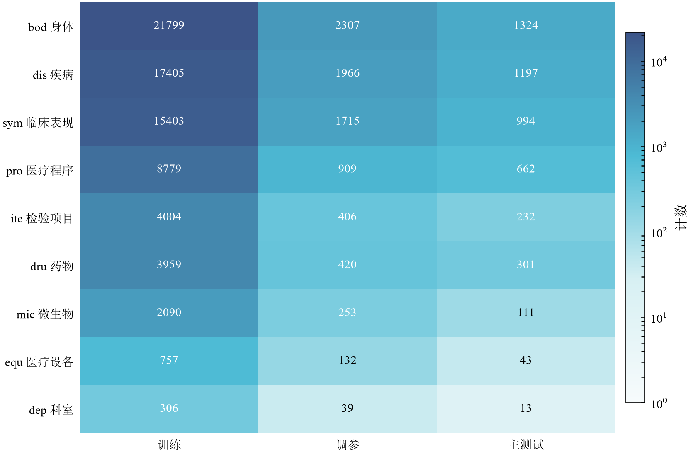

**图 2.** 九类实体数量热图。颜色为对数刻度，格内为原始计数。来自 `outputs/metrics/split_profile.json` 的 `splits.*.type_counts`。

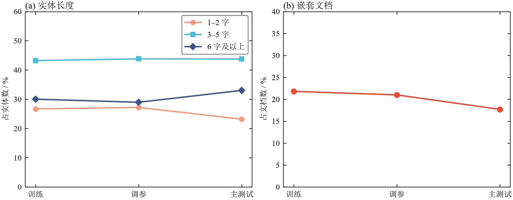

**图 3.** 实体长度与嵌套比例。(a) 各长度区间占该划分实体数的百分比；(b) 嵌套文档占该划分文档数的百分比。比例由 `entity_length_counts`、`nested_docs` 除以对应总数得到。`empty_docs` 为训练 63、调参 5、主测试 4。字段均在 `outputs/metrics/split_profile.json`。

数值目标：待人填写。本步不设目标 F1。

## ② 相关工作与方案选型

本项目选题为任务书方向 **B（信息抽取 / 序列标注）**，不是方向 A（领域 RAG 问答）或方向 C（提示 vs LoRA）。选型表回应模板要求的「为什么不用 RAG / 为什么不用大模型 LoRA」：不用 RAG，是因为待抽实体已在当前句子中，外部检索不直接决定 `start_idx`/`end_idx`/`type`；不用大模型 LoRA，是因为监督微调已由 BERT-BIO 承担，大模型侧用冻结权重的提示做对照，优先跑完基线—监督—提示—评测链。文献上，CMeEE 类中文医疗 NER 常见嵌套，标准 BIO 常保留最长跨度或丢弃冲突实体；中文医疗 NER 上指令微调通常优于少样本提示，但成本高于提示。

| 备选方案 | 优点 | 缺点 | 本项目是否采用 | 理由 |
| --- | --- | --- | --- | --- |
| 词典全匹配与最长匹配 | 无需训练、实现简单、结果可复现；覆盖训练集已见表面词；全匹配偏召回，最长匹配可压低重叠切分带来的假正例 | 未见词与写法变体无法命中；同表多义靠频次/字典序启发式；几乎不利用上下文，嵌套与消歧弱 | 已实现，见 `outputs/metrics/dictionary_baseline.csv` | 方向 B 要求非大模型基线。只用 `data/processed/train.json` 建词典，在同一主测试上给出严格实体级下界（最长匹配 Micro-F1 0.392433） |
| BERT-BIO 监督微调 | 有标签监督，可学边界与九类类型；对齐课程序列标注与预训练微调；主测试实体级明显高于词典（0.634777 vs 0.392433） | 每位置单标签，嵌套无法完整保留（主测试 BIO 舍弃 839/4877）；子词切分有跨度未对齐；token 级 F1（0.776996）高于严格实体级，口径不可混用 | 已实现，见 `outputs/metrics/bert_bio.csv` | 方向 B 的主监督方案，对应「逐位置分类」与实体级评测。配置见 `configs/bert_bio.yaml`（`bert-base-chinese`） |
| Qwen2.5-3B 提示 | 不更新权重即可换示例数；对应提示学习；可记录延迟与输入/输出 token，便于成本对照 | 生成式输出需解析，存在 parse_failures 与 surface_mismatches；主测试实体级 F1 约 0.01–0.02，远低于 BERT；本地 4bit 推理单样本延迟约 6–11 秒 | 已实现，见 `outputs/metrics/qwen_3b.csv` 与 `outputs/metrics/qwen_3b_one.csv` | 在同一主测试上对照「监督微调 vs 提示」。调参集上比较 0/1/3 条示例，`selected_shots=1` 后再评主测试 |
| RAG | 可检索外部知识或相似句，利于低上下文消歧、问答溯源；检索增强 NER 在部分共享任务上有用 | 「召回是上限」：检索噪声会拖累抽取；IE 上检索内容还需标签兼容，否则易误导边界/类型；本任务证据主要在输入句内，外挂语料不直接解决严格跨度匹配 | 未实现 | 属方向 A。方案已定：输入已含待抽信息，检索不能直接解决边界与类别。仓库无检索与引用校验脚本 |
| LoRA | 低秩适配、少改基座参数；算力低于全参微调；中文医疗 NER 上微调/适配器常明显优于 in-context 提示 | 仍需训练管线、显存与超参（秩等）；与方向 C 重叠；截止前加做会挤占必做的错误分析与报告 | 未实现 | 非必做。领域适配由 BERT-BIO 完成；Qwen 侧保持冻结权重提示，以隔离「提示条数」因素。仓库无 LoRA 训练脚本 |

仓库里没有 RAG 或 LoRA 的训练与检索脚本。BERT-BIO 使用 `configs/bert_bio.yaml` 的 `model_path: D:/models/bert-base-chinese`。Qwen 使用 `configs/qwen_3b.yaml` 的提示模板，不更新模型权重。数字出处：词典与 BERT 见上表 CSV；Qwen 分数与成本见 `qwen_3b.csv`、`qwen_3b_one.csv` 及对应 `*_cost.json`；BIO 舍弃见 `outputs/metrics/bio_dropped_entities.json`；入选条数见 `outputs/metrics/qwen_shot_count_selection.json`。

## ③ 系统设计

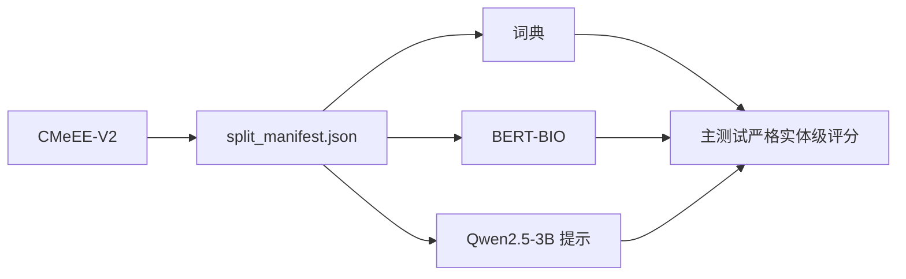

**图 4.** 已实现的数据流，对应模板第③节要求的总体架构图。图中是 CMeEE-V2、`split_manifest.json`、词典、BERT-BIO、Qwen2.5-3B 提示和主测试严格实体级评分。

词典只从 `data/processed/train.json` 收表面。BERT-BIO 读取 train、tune、test 三份已划分文件，配置在 `configs/bert_bio.yaml`。Qwen 提示的示例下标来自 train，主测试预测写在 `outputs/predictions/`。评分比较 `start_idx`、`end_idx`、`type`。

## ④ 实现细节

BERT 配置：`configs/bert_bio.yaml` 中 `learning_rate` 为 `3.0e-5`，`batch_size` 为 8，`gradient_accumulation_steps` 为 2，`max_length` 为 256，`seed` 为 42，`fp16` 为 true。运行记录在 `outputs/logs/train_bio.log`。

子词切分与边界。`outputs/logs/train_bio.log` 记录：

- `train_token_span_mismatch=156`
- `tune_token_span_mismatch=34`
- `test_token_span_mismatch=12`

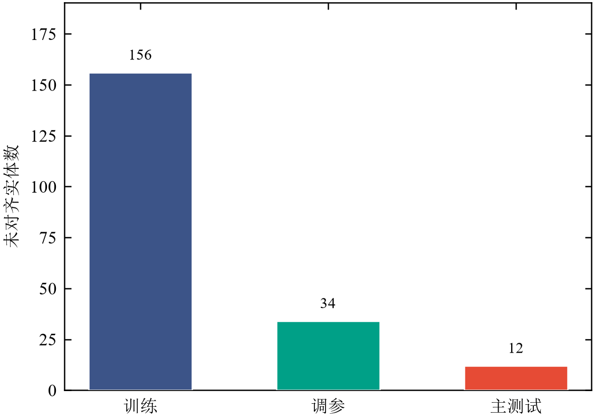

**图 5.** 子词跨度未对齐的实体数。柱顶为原始计数。计数来自 `outputs/logs/train_bio.log` 的 `train_token_span_mismatch`、`tune_token_span_mismatch`、`test_token_span_mismatch`。

Qwen 配置在 `configs/qwen_3b.yaml`：`temperature` 为 0，`do_sample` 为 false，`max_new_tokens` 为 1536。环境是 `medical_ner`，Python 3.11.17，解释器 `D:/programdata/anaconda_envs/envs/medical_ner/python.exe`。Qwen 为本地 4bit 推理。

## ⑤ 评估

**测试集。** 主测试索引以 `data/processed/split_manifest.json` 为准。`outputs/logs/train_bio.log` 的 `test_documents=1000`，`test_gold=4877`。词典和少样本示例只读 `data/processed/train.json`。

**指标口径。** 实体级：`start_idx`、`end_idx`、`type` 都相同才算对，区间左闭右开。`bert_bio_token` 是 `outputs/metrics/bert_bio.csv` 里的 token 行。下表其余行按各 CSV 的方法名抄入，不把调参集 F1 写入本表。

### 主测试

| 方法 | precision | recall | micro_f1 | tp | fp | fn | 平均延迟（秒） | 平均输入 token | 平均输出 token |
| --- | ---: | ---: | ---: | ---: | ---: | ---: | ---: | ---: | ---: |
| `dictionary_all` | 0.167021 | 0.516096 | 0.252369 | 2517 | 12553 | 2360 |  |  |  |
| `dictionary_longest` | 0.343711 | 0.457248 | 0.392433 | 2230 | 4258 | 2647 |  |  |  |
| `bert_bio_token` | 0.795151 | 0.759651 | 0.776996 | 16726 | 4309 | 5292 |  |  |  |
| `bert_bio_entity` | 0.688144 | 0.589092 | 0.634777 | 2873 | 1302 | 2004 |  |  |  |
| `qwen_3b_zero` | 0.022067 | 0.007792 | 0.011517 | 38 | 1684 | 4839 | 6.418967 | 228.386 | 71.522 |
| `qwen_3b_three` | 0.027155 | 0.017634 | 0.021382 | 86 | 3081 | 4791 | 10.537989 | 629.386 | 124.49 |
| `qwen_3b_one` | 0.030572 | 0.017634 | 0.022367 | 86 | 2727 | 4791 | 10.691977 | 417.386 | 98.695 |

词典两行来自 `outputs/metrics/dictionary_baseline.csv`。BERT 两行来自 `outputs/metrics/bert_bio.csv`。`qwen_3b_zero` 与 `qwen_3b_three` 的 P/R/F1 和 TP/FP/FN 来自 `outputs/metrics/qwen_3b.csv`，延迟和 token 来自 `outputs/metrics/qwen_3b_cost.json` 的 `mean_latency_sec`、`mean_input_tokens`、`mean_output_tokens`。`qwen_3b_one` 的分数来自 `outputs/metrics/qwen_3b_one.csv`，延迟和 token 来自 `outputs/metrics/qwen_3b_one_cost.json` 的同名字段。词典和 BERT 没有成本文件，这四格留空。

下面三张图与主测试表使用同一批文件。

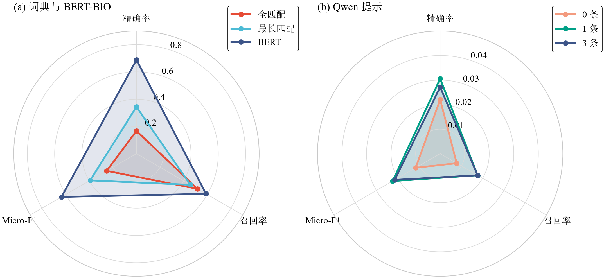

**图 6.** 主测试严格实体级指标的雷达图。(a) 词典与 BERT-BIO 实体级，径向最大值为 0.9；(b) Qwen 提示，径向最大值为 0.05。两图径向范围不同。`bert_bio_token` 不在本图。数值与主测试表相同。

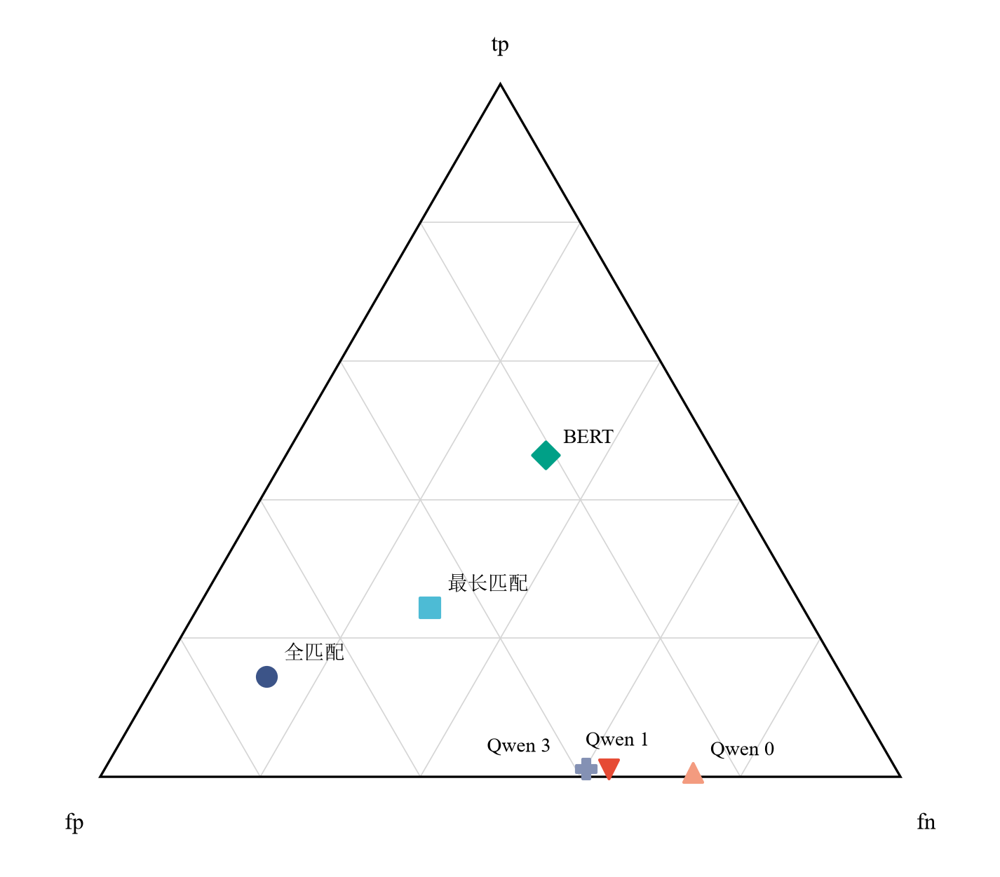

**图 7.** 主测试严格实体级 tp、fp、fn 的三元图。点的位置由三者占 tp+fp+fn 的比例决定。`bert_bio_token` 不在本图。原始计数见主测试表。

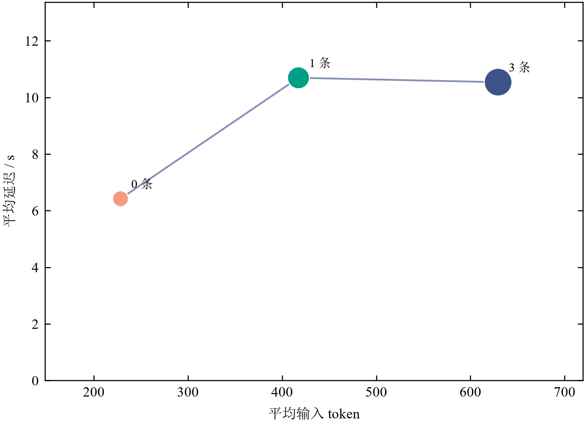

**图 8.** Qwen 主测试成本。横轴为平均输入 token，纵轴为平均延迟，点的面积表示平均输出 token，折线按提示 0、1、3 条连接。词典和 BERT 没有成本文件，不在本图。完整数值见主测试表，来自 `outputs/metrics/qwen_3b_cost.json` 与 `outputs/metrics/qwen_3b_one_cost.json`。

`outputs/logs/qwen_3b.log` 与 `outputs/logs/qwen_shot_count.log` 均有 `api_unit_price=none`。

### 主测试解析计数

这三列不并进上一张 F1 表。

| 方法 | parse_failures | invalid_entities | surface_mismatches | 文件 |
| --- | ---: | ---: | ---: | --- |
| `qwen_3b_zero` | 32 | 164 | 1668 | `outputs/metrics/qwen_3b_cost.json` |
| `qwen_3b_three` | 25 | 473 | 3058 | `outputs/metrics/qwen_3b_cost.json` |
| `qwen_3b_one` | 17 | 217 | 2694 | `outputs/metrics/qwen_3b_one_cost.json` |

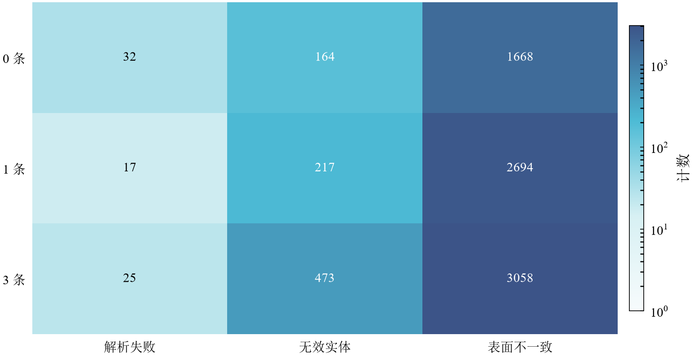

**图 9.** Qwen 主测试解析计数热图。颜色为对数刻度，格内为原始计数。行按提示 0、1、3 条排列。

### BIO 与实体级口径

`outputs/metrics/bert_bio.csv` 的两行是 `bert_bio_token` 与 `bert_bio_entity`，数字见主测试表。

`outputs/metrics/bio_dropped_entities.json` 的 `total` 与 `by_type`：

| 划分 | gold | total | dis | sym | dru | equ | pro | bod | ite | mic | dep |
| --- | ---: | ---: | ---: | ---: | ---: | ---: | ---: | ---: | ---: | ---: | ---: |
| train | 74502 | 13702 | 393 | 10 | 58 | 55 | 583 | 10706 | 1743 | 153 | 1 |
| tune | 8147 | 1458 | 31 | 1 | 9 | 9 | 51 | 1154 | 186 | 17 | 0 |
| test | 4877 | 839 | 25 | 0 | 2 | 2 | 26 | 657 | 123 | 4 | 0 |

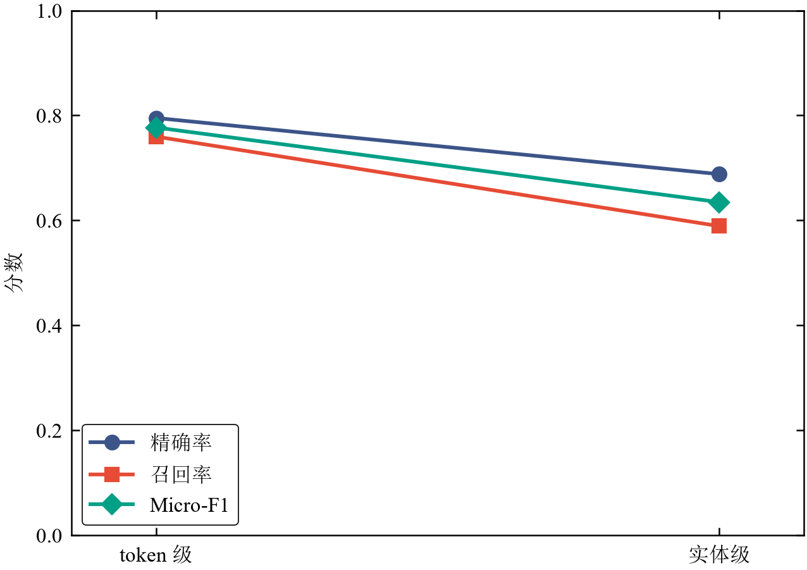

**图 10.** 同一 BERT-BIO 检查点上，token 级到严格实体级的斜率图。三条线为精确率、召回率与 Micro-F1。数值来自 `outputs/metrics/bert_bio.csv`。

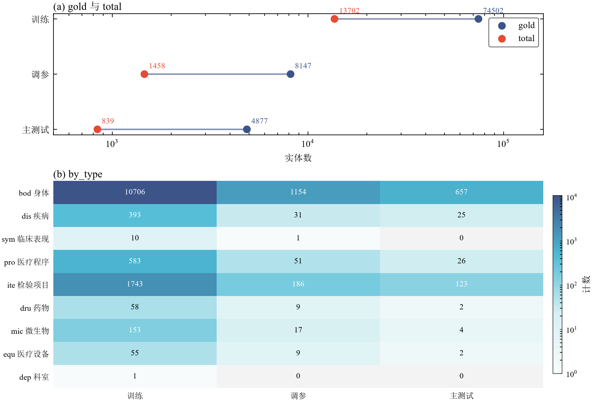

**图 11.** BIO 编码舍弃的实体。(a) 各划分 `gold` 与 `total` 的哑铃图，横轴为对数刻度；(b) `by_type` 热图，颜色为对数刻度，格内为原始计数。来自 `outputs/metrics/bio_dropped_entities.json`。

### 提示与监督微调

监督微调的主测试行是 `bert_bio_token` 与 `bert_bio_entity`，见图 10。提示的主测试行是 `qwen_3b_zero`、`qwen_3b_one`、`qwen_3b_three`，分数见图 6，延迟和 token 见图 8。文件仍是 `outputs/metrics/bert_bio.csv`、`outputs/metrics/qwen_3b.csv`、`outputs/metrics/qwen_3b_one.csv`、`outputs/metrics/qwen_3b_cost.json` 与 `outputs/metrics/qwen_3b_one_cost.json`。

### 调参集（1,500 条，不是主测试）

行来自 `outputs/metrics/qwen_shot_count_tune.csv`。延迟和 token 来自 `outputs/metrics/qwen_shot_count_cost.json` 的 `mean_latency_sec`、`mean_input_tokens`、`mean_output_tokens`。`outputs/metrics/qwen_shot_count_selection.json` 的 `selected_shots` 为 1。

| 方法 | precision | recall | micro_f1 | tp | fp | fn | 平均延迟（秒） | 平均输入 token | 平均输出 token |
| --- | ---: | ---: | ---: | ---: | ---: | ---: | ---: | ---: | ---: |
| `qwen_shot_0` | 0.025696 | 0.008838 | 0.013152 | 72 | 2730 | 8075 | 8.695468 | 231.228667 | 74.593333 |
| `qwen_shot_1` | 0.032761 | 0.018043 | 0.023271 | 147 | 4340 | 8000 | 12.472886 | 420.228667 | 99.198667 |
| `qwen_shot_3` | 0.029477 | 0.017921 | 0.022290 | 146 | 4807 | 8001 | 12.660887 | 632.228667 | 125.242 |

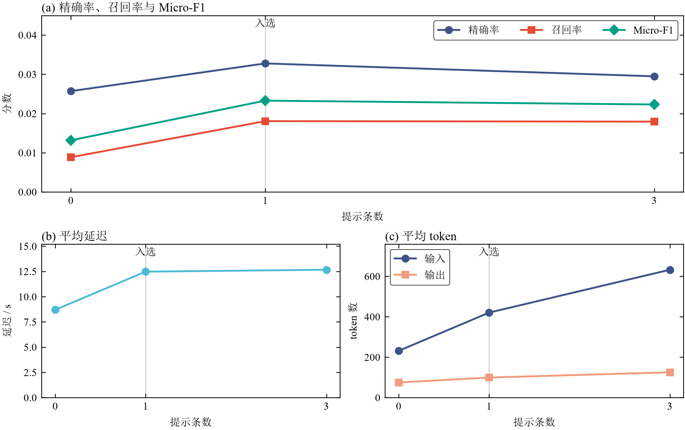

**图 12.** 调参集上的提示条数，共 1,500 条，不是主测试。(a) 精确率、召回率与 Micro-F1；(b) 平均延迟；(c) 平均输入与输出 token。横轴 1* 对应 `selected_shots=1`。来自 `outputs/metrics/qwen_shot_count_tune.csv`、`outputs/metrics/qwen_shot_count_cost.json` 与 `outputs/metrics/qwen_shot_count_selection.json`。完整数值见上表。

比较句：待人填写。

## ⑥ 错误分析与局限

三条样例由 `scripts/export_error_examples.py` 写入 `outputs/errors/examples.json`。每类取该判定下最小的 `source_index`。JSON 里的 `attribution` 与 `improvement` 仍是空字符串。下表和各条下面的段落是根据样例、项目代码和文献写的归因与改进，供确认。

| # | 失败样例（输入 → 输出） | 归因（数据 / 模型 / 提示 / 检索 / 评测口径） | 可能的改进 |
| --- | --- | --- | --- |
| 1 | 见下方「解析失败」。`method=qwen_3b_one`，`source_index=95` | 提示 / 模型。生成在 JSON 未闭合处被 `max_new_tokens` 截断，解析器将该篇 `pred` 记为空。重复块中的字符下标已超出句长。 | 只生成表面和类型，下标用原文精确匹配回填；提高 `repetition_penalty`，并在 JSON 闭合后停止。 |
| 2 | 见下方「边界错误」。`method=bert_bio`，`source_index=0` | 模型把相邻的「儿童」划进 `bod` 与 `sym`。数据经 BIO 压平后，与长实体重叠的内层 `bod` 不进入训练标签。严格三元组把边界不一致计为未命中。 | 用可重叠的跨度解码保留内层实体；患者指称不并入身体或症状。 |
| 3 | 见下方「类型错误」。`method=bert_bio`，`source_index=22` | 模型 / 标注口径。「心脏损害」的跨度与金标相同，金标为 `sym`，预测为 `dis`。规范里器官损伤可标疾病，临床表现内部又可嵌套身体。 | 在标签说明中写清这两类的区分，并改用能同时输出外层表现和内层身体的解码。 |

### 解析失败

`prediction_file`：`outputs/predictions/qwen_3b_one.json`。`attribution` 与 `improvement` 均为空字符串。`pred` 为 `[]`。`discarded` 为 `[]`。`raw_output` 全文在该条记录中。

输入：

> 7.肾上腺皮质激素严格除外禁忌证后，重症患儿（高热、咳重、气促、胸部X线片改变明显且进展快，或伴有其他脏器损害）在加强支持治疗的前提下可选用。

`gold`：

| start_idx | end_idx | type | entity |
| ---: | ---: | --- | --- |
| 2 | 9 | dru | 肾上腺皮质激素 |
| 23 | 25 | sym | 高热 |
| 26 | 28 | sym | 咳重 |
| 29 | 31 | sym | 气促 |
| 32 | 45 | sym | 胸部X线片改变明显且进展快 |
| 32 | 37 | pro | 胸部X线片 |
| 49 | 55 | dis | 其他脏器损害 |

**归因。** `configs/qwen_3b.yaml` 中 `max_new_tokens` 为 1536，`repetition_penalty` 为 1.0，`temperature` 为 0。该条 `raw_output` 以 `{"entities":[` 开头，末尾停在 `start_idx":393,"end_idx":395},{"`，花括号未闭合。本句长度为 71。`src/models/qwen_prompt.py` 的 `parse_model_output` 只有在读到完整 JSON 对象且含 `entities` 列表时才令 `parse_ok` 为 true，否则 `pred` 为 `[]`，`discarded` 也为 `[]`。生成内容把「高热」「咳重」「气促」「胸部X线片改变明显且进展快」等表面按递增下标反复写出，下标已大于句长。主测试 `qwen_3b_one` 的 `parse_failures` 为 17，`surface_mismatches` 为 2694，见 `outputs/metrics/qwen_3b_one_cost.json`。Semin、Dušek 与 Kasner 将生成式跨度标注分为整段标注、数字下标和表面匹配，并说明解码器没有与输入字符对齐的机制，数字下标容易错位（arXiv:2601.16946）。本项目提示要求同时写出表面和 `start_idx`/`end_idx`，属于数字下标。

**可能的改进。** 提示只要求实体表面和类型，下标由 `text[start:end]` 与表面一致的匹配回填。生成侧将 `repetition_penalty` 调到大于 1，或在 JSON 对象闭合后停止，并把未闭合输出标成截断。这些改动本报告没有重跑。

### 边界错误

`prediction_file`：`outputs/predictions/bert_bio.json`。模型输出字段是 `token_pred`，共 1 个窗口、40 个标签，全文在 `outputs/errors/examples.json` 该条。

输入：

> 对儿童SARST细胞亚群的研究表明，与成人SARS相比，儿童细胞下降不明显，证明上述推测成立。

`gold`：

| start_idx | end_idx | type | entity |
| ---: | ---: | --- | --- |
| 3 | 12 | bod | SARST细胞亚群 |
| 19 | 25 | dis | 成人SARS |
| 30 | 34 | sym | 细胞下降 |
| 30 | 32 | bod | 细胞 |

`pred`：

| start_idx | end_idx | type | entity |
| ---: | ---: | --- | --- |
| 1 | 12 | bod | 儿童SARST细胞亚群 |
| 19 | 25 | dis | 成人SARS |
| 28 | 34 | sym | 儿童细胞下降 |

`token_pred` 第一个窗口：`O, B-bod, I-bod, I-bod, I-bod, I-bod, I-bod, I-bod, O, O, O, O, O, O, O, B-dis, I-dis, I-dis, O, O, O, B-sym, I-sym, I-sym, I-sym, I-sym, I-sym, O, O, O, O, O, O, O, O, O, O, O, O, O`。

**归因。** 金标 `bod` 为 `[3,12)`「SARST细胞亚群」，预测为 `[1,12)`「儿童SARST细胞亚群」；金标 `sym` 为 `[30,34)`「细胞下降」，预测为 `[28,34)`「儿童细胞下降」。两处都把左侧相邻的「儿童」划进实体。「成人SARS」`[19,25)` 与金标一致。金标另有 `[30,32)` `bod`「细胞」，与「细胞下降」重叠。`src/models/bio.py` 的 `flatten_entities` 按长度降序贪心保留互不重叠的实体，较短的内层被舍弃。主测试 `outputs/metrics/bio_dropped_entities.json` 的 `total` 为 839，其中 `bod` 为 657。CHIP 2020 的任务说明规定：临床表现内部允许嵌套其他八类，其余类别按最大单位标注。张欢等的标注规范同样把嵌套放在临床表现内部，并把程度、频率一类修饰并入临床表现（CCL 2020）。BIO 每个位置只有一个标签，训练时内层「细胞」不在标签中。严格三元组要求 `start_idx`、`end_idx`、`type` 全同，边界外扩和未输出的内层都会进入假正例或假负例。Li 等写明 CMeEE-V2 中约 32% 的实体处于嵌套结构，逐位置 BIO 留不下内层实体。本条的外扩来自模型边界，内层缺失来自压平。

**可能的改进。** 解码改为按跨度打分，使重叠的 `bod` 与 `sym` 可以同时保留。文献中的多头 biaffine 与 GlobalPointer 属于这一类，本仓库没有这些实验。边界上把「儿童」这类患者指称与身体、症状分开。

### 类型错误

`prediction_file`：`outputs/predictions/bert_bio.json`。`token_pred` 共 1 个窗口、32 个标签。

输入：

> SARS患儿有部分出现心脏损害，对有心脏损害者应进行床边动态心电监护。

`gold`：

| start_idx | end_idx | type | entity |
| ---: | ---: | --- | --- |
| 0 | 4 | dis | SARS |
| 11 | 13 | bod | 心脏 |
| 11 | 15 | sym | 心脏损害 |
| 18 | 20 | bod | 心脏 |
| 18 | 22 | sym | 心脏损害 |
| 26 | 34 | pro | 床边动态心电监护 |

`pred`：

| start_idx | end_idx | type | entity |
| ---: | ---: | --- | --- |
| 0 | 4 | dis | SARS |
| 11 | 15 | dis | 心脏损害 |
| 18 | 22 | dis | 心脏损害 |
| 26 | 34 | pro | 床边动态心电监护 |

`token_pred` 第一个窗口：`B-dis, O, O, O, O, O, O, O, B-dis, I-dis, I-dis, I-dis, O, O, O, B-dis, I-dis, I-dis, I-dis, O, O, O, O, B-pro, I-pro, I-pro, I-pro, I-pro, I-pro, I-pro, I-pro, O`。

**归因。** `[11,15)` 与 `[18,22)` 的表面都是「心脏损害」。金标类型为 `sym`，并在 `[11,13)`、`[18,20)` 嵌套 `bod`「心脏」。预测把两处都标成 `dis`，对应 `token_pred` 为 `B-dis` 加三个 `I-dis`。`SARS` 与「床边动态心电监护」的类型和边界与金标一致。张欢等将「器官或细胞受损」列入疾病，又规定临床表现内部可以嵌套身体（CCL 2020）。「损害」因此落在两类的交界上。解析失败那条（`source_index=95`）的金标把「其他脏器损害」标为 `dis`，本条把「心脏损害」标为 `sym`。压平后训练标签只保留较长的外层；模型仍把外层预测成 `dis`，BIO 也不会再为内层「心脏」单给一个标签。

**可能的改进。** 在 BERT 的类别说明和 Qwen 提示中写明：可独立成立的器官损伤用 `dis`；作为表现并且内部还有身体部位时，外层用 `sym`、内层用 `bod`，并给出对照句。解码改为可重叠跨度后，内层「心脏」才有单独的输出位置。本步没有按修改后的提示重新推理。

**局限。** 词典和 BERT 没有延迟与 token 成本文件，主测试表对应格子为空。Qwen 为本地推理，两份日志写 `api_unit_price=none`。官方 `CMeEE-V2_test.json` 无标签，不参与评分。主测试 BIO 舍弃 839/4877 个金标实体，其中 `bod` 为 657，扁平标签覆盖不了规范允许的嵌套。严格 Micro-F1 把边界部分重合计为一对假正例和假负例。`qwen_3b_one` 在主测试上有 17 次解析失败，失败文档的预测为空；提示要求模型自报字符下标，同次运行的 `surface_mismatches` 为 2694。项目使用 `bert-base-chinese` 与冻结的 Qwen2.5-3B 4bit 提示，没有医疗领域继续预训练、约束 JSON 解码或嵌套解码，也没有 bootstrap。上面三条改进都未重跑。

本节约用的外部资料：张欢、宗源、常宝宝、穗志方、昝红英、张坤丽，《面向医学文本处理的医学实体标注规范》，CCL 2020；CHIP 2020 中文医学文本命名实体识别任务说明（http://cips-chip.org.cn/2020/eval1）；Li 等，Addressing Span Imbalance and Semantic Complexity in Nested Medical Named Entity Recognition；Semin、Dušek、Kasner，Strategies for Span Labeling with Large Language Models，arXiv:2601.16946。

## ⑦ 工程与伦理

成本与延迟见第⑤节两张表和图 8、图 12。Qwen 本地推理，`outputs/logs/qwen_3b.log` 与 `outputs/logs/qwen_shot_count.log` 的 `api_unit_price=none`。仓库代码和配置中不放置 API Key。

数据来自 `data/raw/CMeEE-V2/`。`README.txt` 说明训练集、验证集、无标签测试集和严格 Micro-F1，没有另写数据集许可条款。`CBLUE-main/LICENSE` 的标题是 Apache License 2.0。数据使用范围的最终文字：待人填写。

**AI 使用声明：** 待人填写。

## ⑧ 分工与贡献

| 学号 | 姓名 | 负责模块 | 产出证据（文件 / 提交记录 / 实验） | 工作量占比 |
| --- | --- | --- | --- | --- |
|  |  | 待人填写 | 见下方文件 | 待人填写 |

已有产出文件：

- `data/processed/split_manifest.json`
- `outputs/metrics/dictionary_baseline.csv`
- `outputs/metrics/bert_bio.csv`
- `outputs/metrics/bio_dropped_entities.json`
- `outputs/metrics/qwen_3b.csv`
- `outputs/metrics/qwen_3b_cost.json`
- `outputs/metrics/qwen_3b_one.csv`
- `outputs/metrics/qwen_3b_one_cost.json`
- `outputs/metrics/qwen_shot_count_tune.csv`
- `outputs/metrics/qwen_shot_count_cost.json`
- `outputs/metrics/qwen_shot_count_selection.json`
- `outputs/predictions/dictionary_all.json`
- `outputs/predictions/dictionary_longest.json`
- `outputs/predictions/bert_bio.json`
- `outputs/predictions/qwen_3b_zero.json`
- `outputs/predictions/qwen_3b_three.json`
- `outputs/predictions/qwen_3b_one.json`
- `outputs/errors/examples.json`
- `outputs/logs/train_bio.log`
- `outputs/logs/qwen_3b.log`
- `outputs/logs/qwen_shot_count.log`
- `configs/data.yaml`
- `configs/bert_bio.yaml`
- `configs/qwen_3b.yaml`
- `configs/qwen_shot_count.yaml`
- `scripts/export_error_examples.py`
- `scripts/plot_report_figures.py`
- `figures/01_split_scale.png` 至 `figures/12_train_curve.png`

每人一份的贡献声明本步不生成。工作量比例、姓名和学号待人填写。本表须与每人单独提交的《贡献声明表》一致。

---

## 附录

### A. 复现指南

环境与既有命令见 `README.md`。本步新增的只读抽取：

```text
D:/programdata/anaconda_envs/envs/medical_ner/python.exe scripts/export_error_examples.py
```

成功时打印 `EXPORT_OK`。该命令不加载模型，不改预测文件。录屏镜头中的词典重算命令见 `过程文档/录屏分镜.md`，本步没有运行它。

报告中的图由下面的命令从已有指标文件重绘。它不加载模型，不改预测，不改指标：

```text
D:/programdata/anaconda_envs/envs/medical_ner/python.exe scripts/plot_report_figures.py
```

成功时打印 `FIGURES_OK`，图片写到 `figures/`。

### B. 代码结构说明

- `configs/`：数据划分、BERT-BIO、Qwen 提示和提示条数。
- `scripts/`：校验与划分、词典、BERT 训练、Qwen 推理、重算，以及 `export_error_examples.py`、`plot_report_figures.py`。
- `figures/`：报告插图，由 `plot_report_figures.py` 从 `outputs/` 的指标和日志画出。
- `src/data/`：字段、划分、校验。
- `src/baselines/dictionary_ner.py`：词典匹配。
- `src/models/bio.py`：BIO 编解码。
- `src/models/qwen_prompt.py`：提示与输出解析。
- `src/evaluation/metrics.py`：严格实体级 Micro-F1。
- `outputs/predictions/`、`outputs/metrics/`、`outputs/logs/`、`outputs/errors/`：预测、指标、日志和失败样例。

### C. 关键运行日志

- `outputs/logs/train_bio.log`：`train_token_span_mismatch`、`tune_token_span_mismatch`、`test_token_span_mismatch`。
- `outputs/logs/qwen_3b.log`：`api_unit_price=none`。
- `outputs/logs/qwen_shot_count.log`：`api_unit_price=none`，`tune_documents=1500`。

模板附录要求附训练曲线。下图读 `outputs/metrics/bert_bio_history.json`。曲线上的 precision、recall、micro_f1 是调参集字段 `tune_*`，不是主测试。


**图 13.** BERT-BIO 各轮训练损失与调参集分数，纵轴为损失与调参集分数。竖线处为 `best_epoch`。`tune_precision`、`tune_recall`、`tune_micro_f1` 是调参集，不是主测试。来自 `outputs/metrics/bert_bio_history.json`。

- 迭代记录的截图和最终文字：待人填写。

### D. 数据来源与许可说明

原始文件在 `data/raw/CMeEE-V2/`。说明见该目录 `README.txt`。代码许可文件是 `CBLUE-main/LICENSE`（Apache License 2.0）。数据集许可的最终文字：待人填写。
